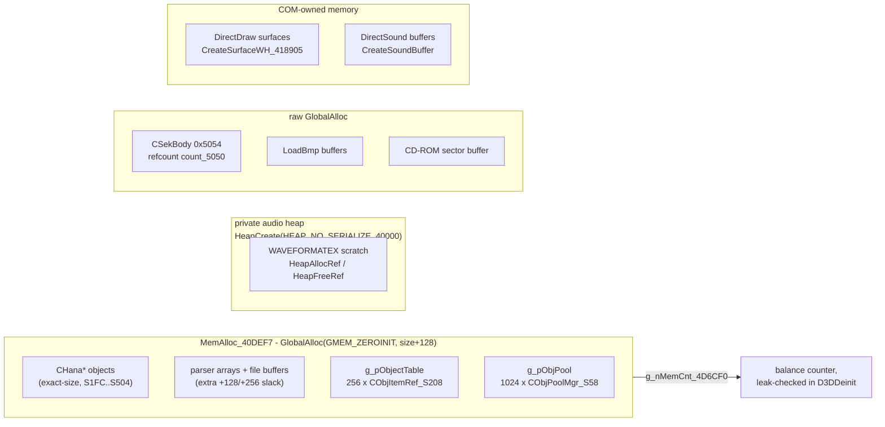
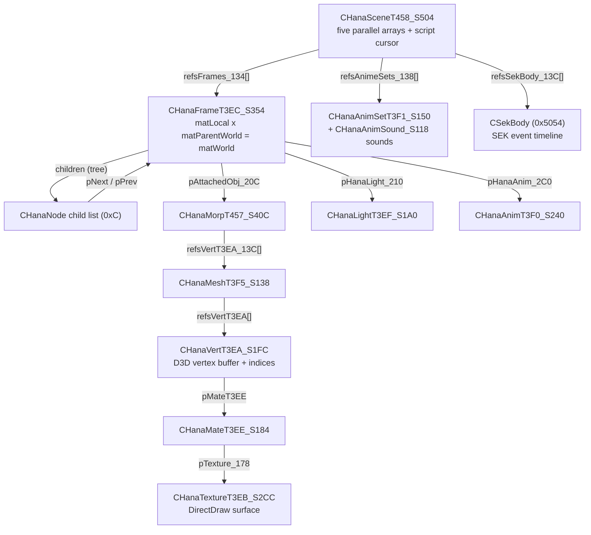
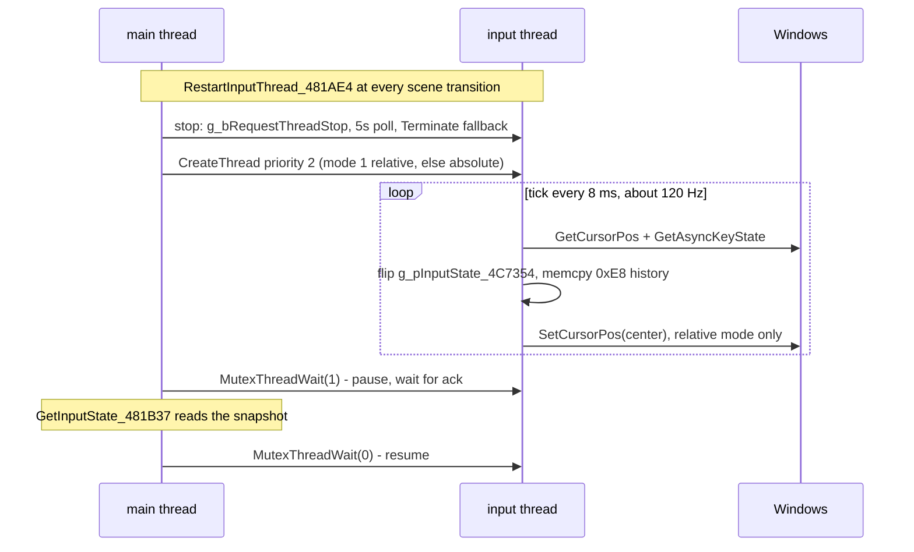

# Part II: Core Architecture & Memory Foundations

## Memory Architecture

There is no CRT allocator in the game: zero `malloc` / `new` / `realloc` anywhere in the
decompiled sources. All memory flows through four channels - the `MemAlloc` wrapper
family, one private Win32 heap for audio, a few raw `GlobalAlloc` call sites, and
DirectX COM objects that own their own memory.

### The primary allocator - MemAlloc_40DEF7

- `hook_MemAlloc_40DEF7(size)` ([src/MemAlloc_40DEF7.cpp](../src/MemAlloc_40DEF7.cpp)):
  `GlobalAlloc(GMEM_ZEROINIT, size + 128)` - zero-initialized, with a fixed +128-byte
  slack per allocation that carries no metadata. The matching `MemFree_40DF64` is
  `GlobalFree` plus a decrement of the balance counter `g_nMemCnt_4D6CF0`. The counter
  resets in `D3DInit`, and `D3DDeinit` logs `MemCnt=%d` at teardown if it is non-zero -
  a whole-game leak sentinel.
- 73 call sites. The parsers sprinkle their own `+128`/`+256` over-allocations on top,
  and every growth path is alloc-copy-free (`MemAlloc` bigger -> `memcpy` -> `MemFree`
  old). Nothing ever shrinks.

### The global object table

`D3DInit_40A894` allocates the name-keyed object registry: `g_pObjectTable` = 256 x
`CObjItemRef_S208` (0x20800 bytes), each record holding two 256-char names, the
`CHanaBase_S130*` pointer, and the `dwType` tag. Slot 0 is a permanent `'%'` sentinel.
`CHanaObj__AddObjItemRef_40B848` ([src/CheckRunGame_4863C8.cpp](../src/CheckRunGame_4863C8.cpp))
inserts first-fit into freed slots, appends when none is free, and grows capacity by
256 (alloc-copy-free). `CHanaObj__RemoveFromGlobalRef_40BD4D` clears the slot for
reuse - except `nIndex_108 == 0`, which never unlinks.

### The draw-batch pool

`g_pObjPool` = 0x16000 bytes = exactly 1024 entries of `CObjPoolMgr_S58`
`{ D3DXMATRIX, pFrame, pVert, fNeedsDraw, nAmbient, bitLightEnables }` - despite the
name it is not a general object pool but the flat per-frame render-batch array.
`AddObjectToPool_40CD32` grows it by 256 entries whenever full (it never refuses);
`HanaVert_DrawBatch(0)` resets `g_nObjCount = 0` each frame; `ProcessFrame_40600C`
clamps the batch sort at 6000 entries.

### CHanaObj lifecycle and refcounting

All `CHana*` objects share one construction idiom (see
[src/CHanaObj__NewFrameT3EC_S354.cpp](../src/CHanaObj__NewFrameT3EC_S354.cpp)):

    MemAlloc(sizeof(T)) -> memset -> dwType = tag
    -> CHanaObj__AddRef_40BFC3 -> AttachHanaObj_40BAB8(name) / AttachChild

Release is IUnknown-style, driven by the refcount at `CHanaBase_S130::nCount_12C`:
each per-type free first checks `nCount_12C <= 1` - if true, free children, arrays and
COM resources, unregister from the object table and `MemFree` itself; otherwise just
`--nCount_12C`. Dispatch is a `switch (dwType)` in `CHanaObj__Free_40C1E4`
([src/CHanaObj__Free_40C1E4.cpp](../src/CHanaObj__Free_40C1E4.cpp), 33 hooked
functions). Sixteen per-type counters `g_nRefVertT3EA` .. `g_nRefMorpT457`
(@0x4D6D14..0x4D6D50) track the AddRef/Free call balance - note they decrement even
when the object survives the call, so they are call counters, not live-object counts.

Faithfully replicated quirks:

- `FreeTexCoordT3F2` ignores the refcount and always frees - inconsistent with every
  sibling type.
- Types `0x3FB`-`0x3FE` log a WARN and do nothing (their destructors were never
  reconstructed).
- Two refcount worlds coexist: `nCount_12C` (MemAlloc'd objects) vs
  `CSekBody::count_5050` (GlobalAlloc'd SEK bodies, freed with `GlobalFree`).

### Side allocators

- Private audio heap: `HanaHeap_Create_427520` = `HeapCreate(HEAP_NO_SERIALIZE, 40000, 0)`
  (lazy singleton, `g_hHeapHandle`@0x5187F0); `HeapAllocRef_427591` / `HeapFreeRef_4275DF`
  carry their own refcount. Sole users: the `WAVEFORMATEX` scratch blocks in
  `LoadWav_422E7B`.
- Raw `GlobalAlloc` users: `ParseSekFile_401039` (`CSekBody`, 0x5054 bytes),
  `LoadBmp_420DF0` (file + palette, with its own `g_nBMPCounts_518388` counter),
  `LoadWavToDS3DBuffer_42277E` (format blocks and the 8-byte `CSoundStruct_8`
  wrapper), and the CD-ROM sector buffer in `CDROM_VerifyDiscSignature_485C50`.
- DirectDraw surfaces via `CreateSurfaceWH_418905` (OFFSCREENPLAIN | SYSTEMMEMORY) - no
  refcounting, raw `Release()` discipline. DirectSound buffers own their sample memory;
  the game only `Lock`/`Unlock`s to stream data in.

The allocation landscape at a glance:

## Core Data Structures & Math Libraries

### The CHanaBase header

Every game object starts with `CHanaBase_S130` ([src/struct.hpp](../src/struct.hpp)):
`dwType` at +0x04 is the class id and the only dispatch discriminator - there are no
vtables anywhere in the CHana family. `szName_8[256]`, object-table slot `nIndex_108`,
and refcount `nCount_12C` follow. All structs are `#pragma pack(push, 1)`, and their
sizes are pinned by 57 `static_assert`s in `AssertHanaStructSize()`
([src/struct.cpp](../src/struct.cpp)). The `_S###` suffix on every struct name is its
sizeof in hex; the `T3EC`-style token is the `dwType` tag.

Type tag registry, as dispatched by `CHanaObj__Free_40C1E4`:

| tag | struct | role |
|-----|--------|------|
| 0x3EA | `CHanaVertT3EA_S1FC` | vertex buffer + index array + render flags |
| 0x3EB | `CHanaTextureT3EB_S2CC` | DirectDraw surface wrapper |
| 0x3EC | `CHanaFrameRootT3EC_S2D4` / `CHanaFrameT3EC_S354` | transform node (one shared tag) |
| 0x3ED | `CHanaFrameArrayT3ED_S138` | frame pointer array |
| 0x3EE | `CHanaMateT3EE_S184` | `D3DMATERIAL7` wrapper |
| 0x3EF | `CHanaLightT3EF_S1A0` | `D3DLIGHT7` wrapper + light index |
| 0x3F0 | `CHanaAnimT3F0_S240` (key `S78`) | keyframe animation (quaternion slerp) |
| 0x3F1 | `CHanaAnimSetT3F1_S150` | animation collection (incl. sounds) |
| 0x3F2 | `CHanaTextureCoordsT3F2_S140` | parallel tu/tv float arrays |
| 0x3F3 / 0x3F4 | `CHanaTextureAnimT3F3_S16C` / set `_S138` | texture animation |
| 0x3F5 | `CHanaMeshT3F5_S138` | group of `CHanaVert` references |
| 0x3F6 | `CHanaSpriteT3F6_S1FC` | 2D sprite with own surface copy |
| 0x3F7 / 0x3F8 | `CHanaMateAnimT3F7_S148` (key `S50`) / set `_S140` | material animation |
| 0x3F9 / 0x3FA | `CHanaLightAnimT3F9_S144` / set `_S13C` | light animation |
| 0x457 | `CHanaMorpT457_S40C` | morph / blending controller |
| 0x458 | `CHanaSceneT458_S504` | scene container |

Caution: `CHanaObj__GetRealPath_486D9A` uses a numerically overlapping directory-code
enum (0x3E8..0x3F2 = 1000..1010: drive root, HNH dir, ODS, SPR, Str, ODF, WAV, GRP,
GRP800, SE, DATA) - same numbers, unrelated meaning.

### The frame hierarchy

`CHanaFrameRootT3EC_S2D4` embeds three `D3DXMATRIX`: `matLocal_138`,
`matWorld_178 = matLocal_138 * matParentWorld_1B8`. Children hang off doubly-linked
`CHanaNode` (0xC) lists; the recursive world update `MtxStackRecursiveMulLocal_4075B0`
uses a real `ID3DXMatrixStack` (Push -> `MultMatrixLocal(&matLocal_138)` -> copy the
top into `matWorld_178` -> recurse into children -> Pop). Frames also carry bounds
(vertex min/max, 8 transformed corners, world AABB), an optional attached morph
(`pAttachedObj_20C`), light (`pHanaLight_210`), animation (`pHanaAnim_2C0`), and fog
fields. `CHanaFrameT3EC_S354` adds a 0x80-byte tail that the constructor deliberately
does not memset - the allocation is `GMEM_ZEROINIT` anyway, so it starts zeroed.

The biggest structure is not a CHana object at all: `CSekBody` (0x5054) holds the SEK
event timeline - 128 items of 0x9C plus `count_5050`, its own refcount.

How the objects reference each other:

### Const data in struct.cpp

[src/struct.cpp](../src/struct.cpp) reconstructs the original .rdata tables: the
200x50 sound-name table (`s###.wav` BGM + `SE###.wav` effects), the 100x50
`G00.GP`..`G98.GP` event-picture names, the 100-entry chapter walk table
`g_arrSceneNo_4C6F78`, save-slot diary text `g_szSceneInfoText_4B5A10` (40x20x80
Shift-JIS, 0xFA00 bytes), the 8x8 Bayer dither thresholds, the 10-step DirectSound dB
volume ladder, and the video-mode whitelist (640/800/1024 at 16/32 bpp).

### Math - pinned D3DX plus a hand-rolled layer

[src/dx7.cpp](../src/dx7.cpp) pins 30 D3DX exports from the game's statically linked
D3DX at their original addresses (context, texture, sprite, and math functions). Only
four are actually reimplemented: `D3DXVec3Normalize`, `D3DXMatrixRotationAxis`,
`D3DXMatrixMultiply`, `D3DXMatrixInverse` (registered together by
`register_D3DXMatrixIdentity_40E450`).

Separately, the game has its own math helpers in the 0x40CBxx-0x40Exxx range:
`MatrixPerspectiveFovLH_40CB94`, `MatrixLookAtLH_40C64A`, `MatIdentity_40E450`,
`Vec3Dot_40E3F0`, `Vec3Set_40E420`, `DegreesToRadians_40DDF3`, `ApplyQTS_4035B1`
(scale x rotation x translation compose), and `ProjectToScreen_40E2A5` with
`BuildViewportMatrix_40E167`. The `Vec3Set` pin needs a union to satisfy both calling
conventions - `__thiscall` at the call sites, `__fastcall` under the MinHook
trampoline:

    union {
      void (__thiscall *member)(D3DXVECTOR3*, float, float, float);
      void (__fastcall *fast)(D3DXVECTOR3*, int, float, float, float);
    } Vec3Set = { ... (0x40E420) };

### Trig tables

`Renderer_InitializeTrigTablesAndPixelFormat` builds degree-indexed float tables
`g_SineTable[360]` and `g_CosineTable[360]` (one entry per degree).
`D3DInitBuffers_40AF60` additionally builds three 360-entry `D3DXVECTOR3` direction
LUTs (`g_arrFwdByYaw360_4CD788`, `g_arrUpByPitch360_4D47C0`,
`g_arrFwdByPitch360_4D58A0`) by rotating the camera frame one degree per step through
D3DX rotation matrices.

### Strings

Fixed `char[256]` arrays dominate - every object, table record, and path is statically
sized. The only dynamic string buffer is the `.STR` script itself:
`ReadStrFile_483567` loads the whole file into `pScene->ptrStrData_260`, and the
interpreter walks it with the cursor triple `dwPtrPos_444` / `dwPtrCurrent_448` /
`dwPtrSize_44C` (the command grammar is documented at the top of
[src/ParseExecStr_487D89.cpp](../src/ParseExecStr_487D89.cpp)). Dialogue glyphs become
`CHanaSpriteT3F6` objects in the `textSprites_264[4][29]` grid.

## Threading & Job Scheduler

There is no job scheduler, no worker pool, and no thread pool - at most two
game-created threads exist at any moment: the input thread and, transiently, a
WAIT-screen thread during heavy scene loads. (The injected-DLL mode adds one startup
event in `hnh_main.cpp` - the only kernel synchronization object in the project. There
are no critical sections anywhere.)

### The input thread

Everything lives in [src/RestartInputThread.cpp](../src/RestartInputThread.cpp):

- `CreateNewThread_4818FD` spawns a plain `CreateThread` at priority 2 (`HIGHEST`).
  Mode 1 = `InputThread_Relative_481637` (gameplay mouse-look; re-pins the OS cursor
  to the virtual center every tick so movement is unbounded); anything else =
  `InputThread_Absolute_4817B1` (menus; free cursor).
- `RestartInputThread_481AE4` tears down and recreates the thread at nearly every
  scene/menu transition (50+ call sites). Stop is cooperative: set
  `g_bRequestThreadStop`, poll `GetExitCodeThread` for up to 5 seconds, then hard
  `TerminateThread` as a last resort.
- The thread body ticks at ~120 Hz (`Sleep(8)`), honors a pause handshake
  (`g_bThreadWait_52F3AD`, acknowledged by `g_bThreadInWaiting_52F3AE`), and maintains
  two 30-slot input-history buffers (`g_arrInputState1_52F1C0` /
  `g_arrInputState2_52F2B0`) as a lock-free double buffer: flip the published pointer
  `g_pInputState_4C7354`, `memcpy` 0xE8 bytes of history into the newly published
  side, sample a fresh state into slot 0. The main thread just reads
  `GetInputState_481B37` - no locks.
- The actual sampling (`GetCursorPos_4811FA`) is not DirectInput: `GetCursorPos` plus
  `GetAsyncKeyState` button masks, with keyboard-emulated mouse nudges. DirectInput
  *is* initialized and acquired in `DInputInit_43AD67`, but `GetDeviceState` is never
  called anywhere - DI is vestigial.
- Main-thread consumers (`GetMouseBtn_45A41B`, `GetMouseXY_45A4D8`,
  `UpdateHeroControl_45A513`) bracket their reads with `MutexThreadWait_4815EC(1)/(0)`
  - despite the name, that is the flag handshake above, not a kernel mutex.

### The WAIT-screen thread

`ToggleWaitScreen_47E3E1` (assault scene loading) creates the second worker: it loads
`Wait.bmp` and blinks it via `FlipToGDISurface` while `g_bWaitScreenOn` is set, with
the same cooperative stop path as the input thread.

### Message pumping

Only two full `PeekMessageA` + `TranslateMessage` + `DispatchMessageA` pumps exist:
the drain-once loop in `WinMain_485CE0` (which dispatches the boot messages covered in
Part I) and the launcher `ShowTitleMenuWnd_428927` busy-spin pump. Every scene loop
instead calls the shared helper `DoPeekMessages_481550` (six `PeekMessageA` flushes
per frame); video playback adds four more flushes inside its MCI position poll.

### Frame timing

No fixed timestep and no throttling sleep: scene loops are free-running
(`DoPeekMessages` -> compute delta -> update -> render -> present). The clock is
`timeGetTime`-based: `FrameTimer_BeginFrame` / `FrameTimer_EndFrame` maintain
`g_timerStart` / `g_timerLast`, and `GetFrameTime_47E79A` returns
`(now - start) * TIMER_SCALE_FACTOR / 1000`, where `TIMER_SCALE_FACTOR` (@0x4C6F74,
default 20.0) is retuned per scene (10-15). Scenes clamp the delta at 5.0 s and
implement fast-forward by multiplying the delta, not by sleeping less. Presentation
uses `UpdateFrame(D3DX_UPDATE_NOVSYNC)` - the game explicitly opts out of vsync
blocking, so effective pacing comes from render workload and blocking
`Lock(DDLOCK_WAIT)` stalls.
