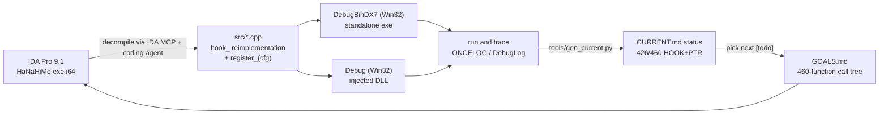
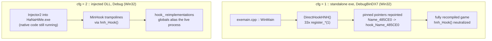
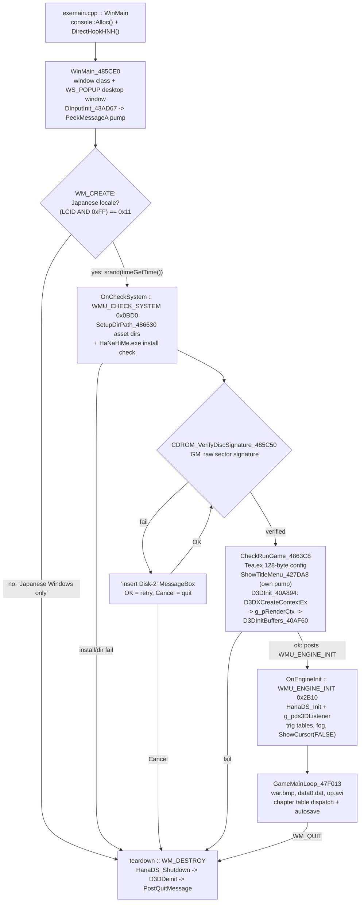

# Part I: Methodology & Boot Sequence

## Reverse Engineering Tooling & Setup

### The Target

A PC game by **TEATIME** released October 2001 (catalog date code `[011019]`), built on DirectX 7
technology, with the original executable `HaNaHiMe.exe`. Every source file in [src](../src/)
opens with the original game banner comment, saved in Shift-JIS encoding.

### Tooling

- Static analysis with **IDA Pro 9.1**. The IDA database (`HaNaHiMe.exe.i64`) and the type dump
  (`HaNaHiMe.exe.h`) live next to the installed game under `APPDIR` (see
  [PropertySheet.props](../PropertySheet.props)), not in the repo.
- Extraction is done through **IDA MCP + a coding agent**: decompile a function, clean up the
  control flow (remove GOTOs, rename `a1`/`a2` args, add comments), and save it into `src/`.
  The workflow spec lives in [AGENTS.md](../../AGENTS.md).
- Occasional dynamic debugging with the Visual Studio **Local Windows Debugger**, plus runtime
  tracing: every reimplemented function logs through `ONCELOG` (once per call site) / `DebugLog`
  into the console allocated at startup.

### Methodology

The approach is inspired by [GTA/re3](https://github.com/GTAmodding/re3/tree/master/) using the
[Ship of Theseus](https://en.wikipedia.org/wiki/Ship_of_Theseus) philosophy: replace original
functions with recompiled versions one by one, testing as they land, until the original binary
is no longer needed.

Coverage follows the call graph from the real entry point `0x49F0E1` (`WinMainCRTStartup`):
all 460 reachable functions are tracked in [GOALS.md](../GOALS.md). Orphaned functions without
xrefs are skipped. The status report [CURRENT.md](../CURRENT.md) is generated by
`tools/gen_current.py` + `tools/scan_cpp.py` and classifies every function as `[HOOK+PTR file]`,
`[HOOK]`, `[PTR]`, `[IMPL]`, or `[todo]` - currently **426/460 fully covered** (`HOOK+PTR`),
26 still `[todo]` (mostly CRT internals).

The replace-test-report loop, from decompilation to the coverage report:

### The Hook Framework

Built on the repo's `SB3ImGuiHook` fork of
[Universal-Dear-ImGui-Hook](https://github.com/Sh0ckFR/Universal-Dear-ImGui-Hook) (ImGui +
**MinHook**, not Detours). It supplies the debug console (`console::Alloc` / `console::Free`),
`DebugLog`, and [src/hnh_hook.cpp](../src/hnh_hook.cpp): `hnh_Hook(addr, detour, name)` wraps
`MH_CreateHook` + `MH_EnableHook`, and can be neutralized with `hnh_HookOff()` / re-armed with
`hnh_HookOn()`.

Function replacement works in two independent layers:

1. **`hook_` pointer redirection** - the primary mechanism. Originals are declared as function
   pointers pinned at their VA in `HaNaHiMe.exe` (image base `0x400000`), e.g.
   `D3DInit_40A894 = (...)0x40A894`. Each `src/*.cpp` reimplements them with a `hook_` prefix
   and exposes a `register_<Name>(int cfg)`:
   - `cfg == 1` (standalone exe): repoint the function pointers to the `hook_` implementations
     and make `hnh_Hook` a no-op - there is no original code left to detour.
   - `cfg == 2` (injected DLL): keep MinHook binary detours live so calls inside still-native
     game code get redirected.
   - Every registrar finishes with `hnh_HookOn()`.
2. **MinHook binary patching** - used only by the injected-DLL configuration, where the
   original executable is still running.

Globals are dual-mode via `#ifdef _USRDLL`: in DLL mode they reference the live game process
(`HINSTANCE &g_hInstance = *(HINSTANCE*)0x52F5C8;`), in standalone mode they are plain statics.
D3DX works the same way: pointers into the game's statically linked D3DX in DLL mode, versus
the real `d3dx.dll` imported through `d3dxd.lib` (`libs/dx7sdk`) in standalone.

The two configurations side by side:

### Naming Conventions

- `Name_485CE0` - the suffix is the original function's VA (base `0x400000`).
- `hook_Name_485CE0` - the recompiled drop-in; the unprefixed name is the pinned original.
- `CHanaObj__Free_40C1E4` - `__` spells `::`; runtime type tags (`dwType` values) survive as suffixes
  (`CHanaObj__NewFrameT3EC_S354`).
- `g_pD3DDevice_4D6C78` - globals carry their original address suffix; marked
  `// WRITABLE` or `// READ-ONLY`.
- Hex-Rays idioms are kept verbatim (`*(_DWORD *)`, `LODWORD(...)`, `a1`/`a2` for unknown
  args, `field_114` / `gap2C5[3]` for unknown struct fields), pinned by `AssertHanaStructSize()`
  static asserts in [src/struct.cpp](../src/struct.cpp).
- Source files are saved Shift-JIS; Japanese string literals are kept byte-exact so window
  class matching still works.

### Build & Run

- Primary configuration **`DebugBinDX7|Win32`** (`Application`): compiles [exemain.cpp](../exemain.cpp)
  (and excludes `dllmain.cpp`) into `re-hnh_DebugBinDX7_Win32.exe`, output straight into
  `$(APPDIR)` = `D:\HaNaHiMe`, with the debugger working directory set to the game asset folder.
- `Debug|Win32` builds the injectable DLL, launched via Injector2 against the original
  `HaNaHiMe.exe` - used while a function is still being swapped over.

## Engine Bootstrapping & Initialization

The standalone boot is **message-driven**: `WinMain_485CE0` only creates the window and pumps
messages; the actual system checks, config, and engine init ride on two custom window messages,
`WMU_CHECK_SYSTEM` (`0x0BD0`) and `WMU_ENGINE_INIT` (`0x2B10`), defined in
[src/WndProcCheckSystem_485FC2.cpp](../src/WndProcCheckSystem_485FC2.cpp).

Overview of the boot flow (the numbered steps below carry the details):

1. [exemain.cpp](../exemain.cpp) `WinMain` -> `console::Alloc()` -> `DirectHookHNH()`
   (`AssertHanaStructSize()` + 33x `register_*(1)` pointer swap, ending with
   `[HNH] All hooking done !`) -> direct call `WinMain_485CE0`.
2. `WinMain_485CE0` ([src/WinMain_485CE0.cpp](../src/WinMain_485CE0.cpp)): single-instance
   `FindWindowA` checks (installer window + game window, Japanese titles kept byte-exact);
   registers `WNDCLASSA` with `WndProcCheckSystem_485FC2`, icon resource `0x69`
   (`res/icon.ico` via `hnhmods.rc`), the system arrow cursor, `GetStockObject(4)` background;
   creates the full-desktop `WS_POPUP` window `g_hwndParent`; initializes DirectInput
   (`DInputInit_43AD67`, `DIMouseKeybInit_43AF33`); runs its `PeekMessageA` pump; then calls
   `GameMainLoop_47F013` and `DestroyWindow`.
3. `WM_CREATE` -> `hook_WndProcCheckSystem_485FC2`: Japanese-locale gate
   (`GetSystemDefaultLCID() & 0xFF == 0x11`), then posts `WMU_CHECK_SYSTEM`.
4. `OnCheckSystem`: `CheckInstalledDirRoot_4869A7` -> `SetupDirPath_486630` builds the asset
   directory paths (`g_szODSPath/SPR/Str/ODF/WAV/GRP/GRP800/SE/DATA`); install check for
   `HaNaHiMe.exe` via `CHanaObj__GetRealPath_486D9A` + `IsFileExists_47E8EE`; the **DRM**
   `CDROM_VerifyDiscSignature_485C50` reads raw CD sectors (NT or Win9x path) and checks the
   4-byte `GM` signature; then `CheckRunGame_4863C8`, which posts `WMU_ENGINE_INIT`.
5. `hook_CheckRunGame_4863C8`: reads the **Tea.ex** config (128 bytes: fog/specular/AA/
   dither/light/shadow/resolution/z-depth defaults) via `ReadFileToBuffer` into globals, and
   writes it back on success. `ShowTitleMenu_427DA8` registers a second window class with
   `WndProcTitleMenu_428C11`, icon `0x69` and cursor `0x68` (`res/cursor.cur`), runs its own
   message pump, and returns `g_bRunGame`. On start it builds a `CD3DInitParam` and retries
   z-depth 16/24/32 calling `D3DInit_40A894`, then `D3DSetRenderStates_4276C0`.
6. `hook_D3DInit_40A894` ([src/ShowTitleMenu.cpp](../src/ShowTitleMenu.cpp)): `D3DXInitialize`
   -> `AllocateDevicesDescArray` -> **`D3DXCreateContextEx` -> `g_pRenderCtx`** (falls back to
   `D3DXCreateContext`) -> allocates the object table (`MemAlloc(256*0x208)`) and pool
   (`MemAlloc(0x16000)`), sets `g_bD3Dinited_4D6C6C = 1` -> enumerates the surface format
   (R8G8B8 / R5G5B5 / R5G6B5 / A4R4G4B4) -> `D3DInitBuffers_40AF60`.
7. `hook_D3DInitBuffers_40AF60`: pulls the device globals out of `g_pRenderCtx->Get*()`
   (`g_pD3DDevice_4D6C78`, `g_pDD_4D6C7C`, `g_pD3D_4D6C84`, back/primary/Z buffers); creates
   the scene/camera/light frames and material; sets view/projection; builds the 360-entry
   yaw/pitch lookup tables; applies ~20 render states; clears the frame.
8. `WMU_ENGINE_INIT` -> `OnEngineInit`: `HanaDS_Init` (DirectSound) ->
   `HanaDS_Create3DListener` -> `g_pds3DListener`; `Renderer_InitializeTrigTablesAndPixelFormat`;
   `SetFogEnable_40DFB0` + fog mode/color/range; `ShowCursor(FALSE)`.
9. `hook_GameMainLoop_47F013` ([src/GameMainLoop_47F013.cpp](../src/GameMainLoop_47F013.cpp)):
   blits the `war.bmp` splash; resets `g_sysDataSave_530170` defaults (volume 2, text speed 1);
   loads the **data0.dat** system save via `CHanaObj__GetRealPath_486D9A(1010)` +
   `ReadFileToBuffer`; `RestartInputThread_481AE4` x2; plays `op.avi`
   (`PlayVideoWith3DAudio_4791A3`); `LoadSoundEffects_47EB7F`; then the forever loop:
   `InGameMenu_4799E2` / `MainMenu_47DF0D` dispatches the chapter table `g_arrSceneNo_4C6F78`
   (1 = dialogue `PlayOdsDialogueScene_477F90`, 2 = explore `PlayExploring_45BCAE`,
   3 = hunt `PlayHunting_44C38D`, 4 = assault `PlayAssault_4703AE`, 5 = ED.avi ending,
   6 = backdrop), autosaving `data0.dat` after each chapter. Frames are presented with
   `g_pRenderCtx->UpdateFrame(D3DX_UPDATE_NOVSYNC)`, with `hook_RecoverLostDevice` handling
   device loss (`DDERR_WRONGMODE` -> `D3DDeinit` + re-init).
10. Teardown, `WM_DESTROY`: `ShowCursor(TRUE)`, stop/release DirectSound + `HanaDS_Shutdown`,
    `Renderer_CleanupFont`, `D3DDeinit`, `PostQuitMessage(0)`.
