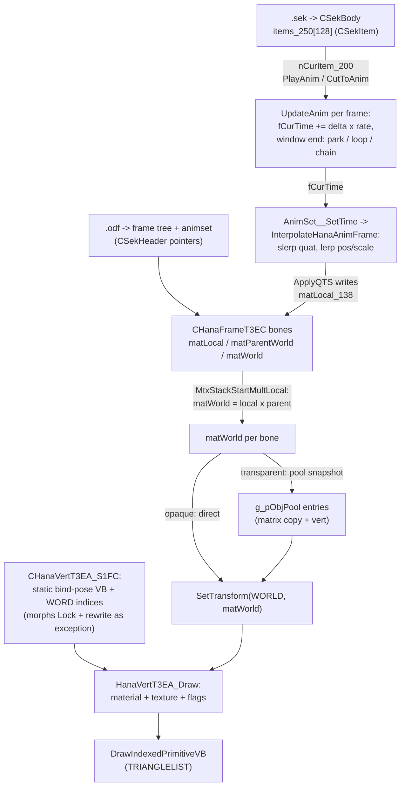

# Character Pipeline - SEK/ODF Data to Rendered Vertices

A companion to the GameCustomLoop experiments: one document tracing the whole
chain from the loaded `.sek` + `.odf` pair through animation selection,
keyframe evaluation, the frame/bone hierarchy, down to the vertex buffer
submit. Field names are the rebuild's (struct.hpp); format-level details are
in Part VI, the wider systems in Parts II-V.

## 1. The loaded pair

`LoadSekAndOdf_4445DD(pszSek, pszOdf, &pBody)` produces one `CSekBody` and
wires it to one model:

1. `ParseSekFile_401039` reads the fixed-layout `.sek` into a `CSekBody`
   (0x5054 bytes, timeline only - no geometry).
2. `SekBody__UpdateTo_4014E4(body, 0)` primes item 0 and recomputes its play
   rate.
3. `ParseODFFile_441F19` parses the `.odf` into the two slots of the body's
   runtime header: `pSekHeader_220->pFrameT3EC` (the frame tree) and
   `->pAnimSetT3F1` (the animation set). **These two pointers are the entire
   SEK-to-model binding** - purely positional, no name lookups.
4. The frame is attached under `g_pSceneFrame`, parked at the origin, posed,
   and `SetTime_403D61(animSet, 1.0)` applies the first pose.

### CSekBody (the timeline side)

| field | role |
|-------|------|
| `szName_0 / szName_100` | names (overwritten by the ODS tag name) |
| `nCurItem_200` | index of the playing item - **this is the animation selector state** |
| `fBlendReq_21C` | pending crossfade request (set by `PlayAnim`) |
| `fBlendWeight_224` | active blend factor (decays during a crossfade) |
| `pSekHeader_220` | runtime header: owns `pFrameT3EC` + `pAnimSetT3F1` |
| `bStepAdvanced_244 / bLooped_248 / bDisabled_24C` | signal flags / kill switch |
| `items_250[128]` | the timeline items (`CSekItem`, below) |
| `count_5050` (nRefCount) | lifetime refcount, `CSekBody__Release_4012FE` |

### CSekItem (one timeline entry)

| field | role |
|-------|------|
| `nMode_0` | 0 = one-shot, 1 = loop |
| `szName_4[64]` | authoring label ("stand", "walk") |
| `nCurStep_44 / nLoopStartStep_48 / nEndStep_50` | step state; endStep doubles as the play-rate divisor |
| `fStartTime_54 / fEndTime_58` | the item's window in the ANIMSET clock (not 0-based!) |
| `fPlayRate_5C` | recomputed as (end-start)/endStep on every switch |
| `fCurTime_60` | the live clock |
| `bAutoNext_70 / nNextItem_74 / nMaxLoops_78` | chaining and loop limit |
| `bNoBlend_7C` | hard cut on entry (skip crossfade) |

## 2. The ODF side (the model)

Every object starts with the `CHanaBase_S130` header - `dwType` at +4 is the
class id and the only dispatch (no vtables), `szName_8[256]`, object-table
slot `nIndex_108`, refcount `nCount_12C`.

- **`CHanaFrameRootT3EC_S2D4` / `CHanaFrameT3EC_S354`** - the bones. Each
  carries **three matrices**: `matLocal_138` (the animated pose, authored or
  keyframe-written), `matWorld_178` (= local x parent world, recomputed by
  the matrix stack each frame), and `matParentWorld_1B8` (cached parent).
  Children hang off doubly-linked `CHanaNode { pData, pPrev, pNext }` lists;
  a bone's geometry is `pAttachedObj_20C`, its per-bone animation hook
  `pHanaAnim_2C0`, its light `pHanaLight_210`.
- **`CHanaVertT3EA_S1FC`** - the drawable: `pD3DVtxBuf_130` (the D3D7 vertex
  buffer), `dwNumVertices_134`, `pVtxIndices` (WORD*), `dwNumIndices_140`,
  `nPrimType_154[1]` (0 = indexed TRIANGLELIST), and the render flags
  (blend mode, unlit, glow, ZBias...). The VB holds the **static bind-pose
  `D3DFVF_VERTEX` data** written once at parse (`Lock` + `qmemcpy`).
- **`CHanaMeshT3F5_S138`** - a group: `refsVertT3EA[]` over
  `nCountVertT3EA_130` vert objects.
- **`CHanaMorpT457_S40C`** - the morph controller: `fMorpParam_130` (the
  live parameter), `pMeshT3F5_138` (target mesh), `refsVertT3EA_13C[]` (the
  MPPL vertex palette), `arrMKeyT3EA_34C[i]` per-slot keyframes
  `{nParam, nVtxIdx}`, easing state, and the sub-object deformers.
- **Animation family** - `CHanaAnimSetT3F1_S150` holds `refsAnimT3F0_138[]`
  and the set clock `fRes_13C` (max key time). Each `CHanaAnimT3F0_S240`
  owns the key array plus the runtime pair `keyCur_14C` / `keyPrev_1C4`
  used for crossfades. A key (`CHanaAnimKeyT3F0_S78`) is time + position +
  scale + quaternion + a pre-baked matrix.

## 3. Selecting an animation

Three selectors, all just setting `nCurItem_200` (plus blend state):

- `CSekBody__PlayAnim_40179D(body, n)` - crossfade switch: sets
  `fBlendReq_21C = 1` unless the item's `bNoBlend_7C`.
- `CSekBody__CutToAnim_4018E1(body, n)` - hard cut, blend state zeroed.
- `SekBody__UpdateTo_4014E4 / UpdateTo2` - conditional switches used by
  scene code (and the experiment keys).

Per frame, `CSekBody__UpdateAnim_4019E1(body, fDelta)`:

1. `fCurTime_60 += fDelta * fPlayRate_5C`.
2. Past `fEndTime_58`: one-shot parks at the end (or chains via
   `CutToAnim(nNextItem_74)` when `bAutoNext_70`); looping wraps to
   `fStartTime_54` until `nMaxLoops_78`, then chains.
3. Blend flush: if `fBlendReq_21C`, `BeginBlend_43A371` snapshots every
   anim's `keyCur_14C -> keyPrev_1C4` and sets `fBlendWeight_224 = 1`.
4. Applies the pose: `SetTime_403D61(animSet, fCurTime_60)`, then
   `BlendStep_43A643` decays the blend (slerp between keyPrev and keyCur by
   `fBlendWeight_224`, which shrinks by `0.1*delta` per frame).

## 4. Keyframes -> the frame

`CHanaAnimSetT3F1__SetTime_403D61(animSet, t)` loops the set's anims and
evaluates each through `InterpolateHanaAnimFrame_40283C`:

- `HanaAnim_FindInterpolationFrame` binary-searches the anim's keys for the
  bracketing pair at time `t`.
- Position/scale lerp, rotation `D3DXQuaternionSlerp`.
- `ApplyQTS_4035B1` composes scale x rotation x translation and writes it
  **directly into the anim's bound frame**: `pHanaFram_130->matLocal_138`.

So a keyframe never touches vertices - it *replaces one bone's local
matrix*. Crossfades work because both ends are cached matrices
(`keyCur`/`keyPrev`) blended before the write; the pre-baked per-key
matrices (`BakeKeyframesT3F0` at load) make single-key spans a copy.

## 5. Frames -> world matrices

`MtxStackStartMultLocal_4074EF()` (called every frame, before rendering)
walks the tree with an `ID3DXMatrixStack`: copy the stack top into the
frame's `matParentWorld_1B8`, push, `MultMatrixLocal(&matLocal_138)`, copy
the new top into `matWorld_178`, recurse children, pop. Net effect:
`matWorld = matLocal x matParentWorld`, cached per bone. The camera is the
special case: when the draw traversal reaches it, the view becomes
`inverse(cameraWorld)` and its children are skipped.

## 6. Frames -> mesh -> vertex buffer

The important clarification: **the frame chain does not rewrite vertex
positions**. The VB keeps its bind-pose bytes from parse time; the animated
pose reaches the GPU through the fixed-function transform:

- During the draw traversal (`ProcessFrame_40600C`), each bone issues
  `SetTransform(D3DTRANSFORMSTATE_WORLD, &frame->matWorld_178)` - so the
  same static vertices are transformed per bone, in hardware.
- `HanaVert_DrawByType_40C54C` dispatches on `dwType` to
  `HanaVertT3EA_Draw_417B27`: material (`diffuse.a` clamp, specular gate),
  texture + address mode, blend/ZBias/flat-shade flags from the vert object,
  then the actual submit:
  `DrawIndexedPrimitiveVB(D3DPT_TRIANGLELIST, pD3DVtxBuf_130, 0,
  dwNumVertices_134, pVtxIndices, dwNumIndices_140, 0)`.
- Transparent verts take the pooled path instead: `AddObjectToPool_40CD32`
  snapshots `{matWorld copy, pFrame, pVert, ambient, lightMask}` and the
  batch passes later replay each entry's matrix through the same
  `SetTransform(WORLD)` before drawing it.

Only two systems ever **modify** VB contents, both at lock level via
`CHanaObj__LockVtxBufT3EA_418544` (`pD3DVtxBuf_130->Lock`):

- **Morph interp** (`HanaMorpT457_Interp_43315F`, driven by
  `fMorpParam_130`): per mesh slot, finds the two palette buffers bracketing
  the parameter in `arrMKeyT3EA_34C[i]`, locks sources + target, and
  `HanaVert_BlendMorph` lerps the **target VB** between them. (The file's
  own comment notes the blend call is gate-disabled in this build.)
- **Sub-object deformers** (`HanaMorpT457_ApplySubs`): per-vertex
  copy/lerp (`HanaVert_CopyMorph` / `HanaVert_LerpMorph_436300`) from a
  source frame's vertices, transformed by frame matrices.

## 7. The chain at a glance

For the experiment harness: the CHARACTER combo = items in section 1, the
ANIMATION browser = `items_250[]` with `PlayAnim`, the SCENE TREE = the
frame tree of section 2, and the hide checkbox = `bAlphaDeferred_130` on the
gate in section 6's traversal.
