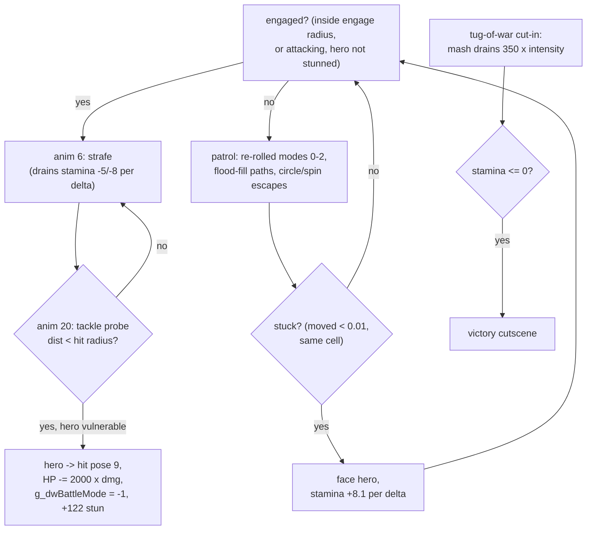
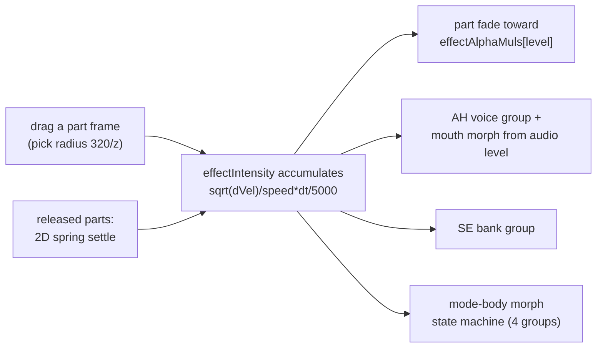

# Part VII: Combat & Scene Systems

The gameplay glue between the runtime (Part III) and the subsystems (Part V): how a
chapter becomes a duel, how the duel is actually won, and what the interactive scenes
do. Scene-loop mechanics, collision, wana attack algorithms, and audio/voice plumbing
are covered in their own parts - this one is about the *systems*.

## The Chapter Map

`g_arrSceneNo_4C6F78` (verified against [src/struct.cpp](../src/struct.cpp)) places the
gameplay steps: **duels (type 3) at steps 7, 9, 21, 24, 35, 38, 49, 52, 55, 67, 70, 73**
(nDuelIndex 0-11) and **assaults (type 4) at steps 10, 11, 25, 26, 39, 40, 56, 57, 74,
75** (iModeId 0-9), always as explore -> duel -> assault clusters; the ending (type 5)
sits at step 80 and the backdrop (type 6) at 82.

Everything about a duel is compiled-in tables keyed by `nDuelIndex`
([src/PlayHunting_44C38D.cpp](../src/PlayHunting_44C38D.cpp)):

- `arrDuelEntries[12][4]`: foe body (`run\o2\o2a`..`run\o1\o1c`), map ODF
  (`Map\M07\at07`..`M08\at08`), map-object ODF (`atNN_o`), ODS scene (`run\MapNN.ods`).
- `arrChapterActMap` `{0,0,1,1,2,2,3,3,3,4,4,4}`: duel -> act block, which selects the
  20 voice wavs (`act\A0X_NN.wav`), the face strip, and BGM
  (duels 0/2/4/6/9 -> `s010.wav`, 7/10 -> `s011.wav`, else `s006.wav`).
- `arrFoeHpMax` `{20000, 20000, 40000, 40000, 35000, 35000, 45000, 45000, 45000,
  40000, 40000, 40000}` - see below: this "HP" is really a stamina pool.
- Wana tables `arrWanaAtkTypes[20][8]` / `arrWanaAtkParams[20][8]` (attack type per
  slot + damage 5000-9000; the param also steers projectile speed class) - the per-duel
  contents are at PlayHunting:283-376.

## The Duel - PlayHunting

### The hero controller - UpdateHeroBody_44474E

The duel hero ([src/SetupHeroEntry_4593E0.cpp](../src/SetupHeroEntry_4593E0.cpp)) maps
mouse input to SEK poses through `g_dwBattleMode` (@0x52ED04, the hero's current action
id; -1 = hit-stun/cutscene lockout, reset to 0 by any control frame):

| input | pose | HP/frame | local-Z lunge | mode |
|-------|------|----------|---------------|------|
| idle (< 500) | 1, then 2 fidget | +0.05 regen | yaw via mouse | 0 |
| LMB tap | 3 | -0.15 | -0.5 | 1 |
| RMB tap | 4 | -0.15 | +0.5 | 3 |
| LMB held (release-then-hold latch) | 6 guard | -0.25 | -1.8 | 2 |
| RMB latch ("skill") | 13 while t<28 | -0.3 | +1.5 | 4 |
| MMB | starts charge pose 16 | | | 5 |
| charge active 1-35 s | 16 spin | -0.5 | -1.8 spin after 6 s | 5 |

Poses are a shared vocabulary across the game: 7/8/9/12 are hit reactions (knockback /
close-trap / tackle / bad item), 13 grants invulnerability frames against every attack,
15/17/26 are cutscene poses, 10/11/13 are the finishers that keep the round alive past
zero HP. Guard has **no damage reduction** - its only combat effect is mode 2 being the
trigger condition for the Close wana trap. The exploring twin
(`UpdateHeroControl_45A513`) differs mainly in poses 5/6 for held attacks and the
`g_fHeroAnimSpeed = (camFactor+2)/3` camera-coupled rate.

### The damage economy - the surprising part

**Hero attacks deal no direct damage.** The light attack (13) and spin (16) have no hit
application whatsoever - no anim-frame windows, no hit volumes. The only paths are:

- **Foe -> hero**: the foe tackle (anim 20) probes a lunge each frame and lands
  `2000 * tuning[1]` damage inside the hit radius while the hero is not invulnerable;
  wana traps deal their table damage (Part V); the tug-of-war costs nothing.
- **Hero -> foe**: exclusively the **tug-of-war mash**: `PlayTugOfWar_45460A` drains
  `350 * intensity` per driven frame, where intensity accumulates from mouse wiggle
  (keyboard samples add `min(|dx|,9)/40`, cursor-off-center samples add `/1000`).

The chain that makes a hit happen: spin pose 16 returns `bChargedHit` during its 1-35 s
strike window -> with `g_dwBattleMode >= 0`, `IsFoeWithinHeroRange_448B78` (a 2.5-unit
forward probe, radius 5) sets `bCinematic` -> next frame runs at 1/4 delta (the
slow-motion effect) -> `PlayTugOfWar` plays. So the spin is an *arming* state, and the
QTE is the damage.

`fActTimer` is the hit-stun economy: decremented at `1.5*delta`, incremented by foe
tackle hits (+122), wana hits (+130/+33/+26/+123), and forced to 120 after a cut-in -
while it is positive the hero only animates, never acts.

### The foe AI - UpdateFoeAI_446A38

`g_dwFoeAiState` 0-2 are patrol modes re-rolled on a random timer, 3 is a boxed-in
escape, 5 is the melee lock (set inside 5 units). The **patrol branch** overrides a
movement mode per duel family: walk-straight (nMode 0), or circling/spinning escapes
(nMode 2/3 via `StepFoeTurn_457EE0`/`StepFoeSpin_45804C`), or the flood-fill pathfinder
(Part V) with distance-banded step budgets. The **engaged branch** (inside the engage
radius, or already attacking, and the hero not in hit-stun) blends a face-hero look-at
and dispatches on the foe's anim: 6 = strafe (sign reversed for duels 4/5), 20 = the
tackle, anything else falls back to strafe.

The foe's "HP" behaves like a **stamina/aggro pool**: it drains from the foe's own
motion (-5/--8 per delta while approaching/circling), regenerates only when stuck
(+8.1 per delta, floor 10), and **resets to full every round** - the mash during
cut-ins is how the player exhausts it.

### Round flow and cutscenes

- **Entry**: each round restart re-parks hero/foe at their captured positions,
  `CutToAnim(1)` + `PlayAnim(1)` on hero and foe, `CutToAnim(0)` on every wana, foe HP
  reset, hero HP re-read from `g_sceneState` (it persists across rounds), the 3-minute
  clock restarted with menu time excluded.
- **Defeat/timeout**: GameOver SE -> `PlayResultsCutscene_455BE2` (three camera phases
  rotating the hero -90/+45/+180 degrees, anims running 3x, mouse-held fast-forward)
  -> `ShowMouseSelectDialog_4573CF` (yes/no hotspots over the wwave shimmer effect).
  "Keep going" heals 15% of max HP and reveals one more wana (`bDisabled_24C`), then
  restarts the round; "no" quits with result 1.
- **Victory**: HP written back to `g_sceneState`, then `PlayVictoryCutscene_455183`:
  hero pose 26 / foe pose 9, phase 1 camera alternating behind-hero/over-shoulder
  anchors at `SetTimerScaleFactor(saved/1.5)` (original: /3.0, kept under `#if 0`),
  phase 2 a slow dolly zooming onto the foe's `_kubi` (neck) frame at /3.0 (original
  /5.0), a dim overlay at alpha 0.7 (original 0.3), and a frozen-frame Blt of the live
  image. These four rebuild deltas are the intentional deviations, all flagged in the
  source.
- **HUD**: `DrawDuelHealthHud_44B23B` draws both gauges as texture-scrolling quads -
  the foe gauge's level indicator swaps face portraits (`pSprites[9..11]` per act) as
  its stamina drops; `DrawClockHud_44AF5B` renders the XXX:XX countdown from digit
  sprites (`0.BMP..9.BMP`, `c.BMP`); the entry viewfinder fades in over the intro ODS
  with an expanding box and banner. All HUD art comes from `InitHudResources_4490A7`
  (SPR-dir strips: run\time/life/renda, button01-06, hunt01-10, mode01-04, per-act
  face gauges).

## Scene Setup

- `LoadSekAndOdf_4445DD` ([src/ParseODS_483932.cpp](../src/ParseODS_483932.cpp)) is the
  universal actor loader: parse the `.sek`, switch to anim item 0, parse the `.ODF`
  into the header's frame/animset pair, attach to the scene root, pose, `SetTime(1.0)`.
  Hero = `otoko\otoko` in both exploring and hunting.
- `SetupHeroEntry_4593E0` places the hero at the n-th `JUMP*` marker frame of the ODS
  scene (position + flattened heading), then backs it off 5 local units. Exploring
  re-runs it on every scene transition; hunting instead uses
  `BindSceneActors_448C72`, which matches ODS scene nodes named `otoko`, `onna`,
  `wana1..8` and parks each actor body there.
- `SetupItemBodies_459F81` (exploring): seven item bodies (`item\i11`..`i17`), placed
  per (sub-stage, map) by the `arrItemPlaceData` table onto `itemN` ODS markers,
  hidden when already collected. Pickup effects (via `ApplyTargetEffect_45A2BA`):
  1 = +20000 HP, 2 = +6600 HP and max, 3 = camera factor 1.5, 4 = +30 s, 5 = -20000 HP,
  6 = camera factor 0.5, 7 = -30 s; bad items trigger pose 12, good ones 14.
- `BuildMapSubFrames_443DD5` recursively computes every map frame's world AABB and
  8-corner set (`Frame_ComputeWorldAABB_407E5B`) - the input for all collision
  fast-rejects and the pathfinding grid.
- **Named anchor frames** are the rig's semantic markers, looked up by name at
  runtime: `_04_kao` (foe face - voice pin), `_kubi` (neck - victory camera),
  `head` (hero head), `Frame5_o00_02_head` (exploring camera), `_kuti_fu1` (mouth -
  the AH voice sounds and audio-driven mouth morph), `_eye_fu1`/`_l_momo`/`_r_momo`
  (tears anchors), and `atari_ue`/`atari_sita` - despite the name ("atari" = hit
  marker), these are **camera framing anchors** for the interactive cut-in, not combat
  hit volumes. All combat hit detection is pure distance probes.

## The Cut-Ins

### PlayTugOfWar_45460A - the struggle QTE

A 3750 ms scripted sequence with a 750 ms intro (FOV ramp 0.2 -> 1.7, camera on the
hero `head` frame) and a 3 s struggle phase: camera pivots around a dropped frame,
the player mashes (`UpdateBodiesInput_4542E0` walks the input ring and *resets it to
center*, so intensity measures absolute wiggle), hero/foe hold poses 17/7, flash
sprites pulse on anim frames 1808-1813, and the foe stamina drains. The outer duel
clock keeps running (its expiry also ends the QTE). Outcomes: timeout / clock expiry /
stamina drained; on a non-expired survival both actors are restored and set to poses
9/20, and the duel grants `fActTimer = 120` lockout.

### The assault interactive cut-in - PlayCutInScene_46A76F

Entered from PlayAssault by clicking the top-right GO strip.
[src/PlayCutInScene_46A76F.cpp](../src/PlayCutInScene_46A76F.cpp):

- **Six effect slots** (k = 0..5) each bind a frame triplet (an arm/tibusa/kuti-R set)
  whose animations are transferred into scratch animsets for the session. Hover-pick
  is by projected screen distance (pick radius `320/z`); grabbing a part and dragging
  moves its frame with a camera constraint, warps the cursor onto a speed circle when
  the normalized drag exceeds range, and accumulates `effectIntensity`
  (`+= sqrt(dVel)/speed*dt/5000`).
- **`effectIntensity` drives everything**: the grabbed frame's fade (toward
  `effectAlphaMuls[g_nHSceneMale_530265]` = {1.0, 0.8, 0.5, 0.2, 0.0} by the scene
  "male" option), the AH voice group (`fEffectTypeToGroup`, 30 wavs in intensity
  groups - playing voices get their volume ramped while the *actual audio level*
  drives the mouth morph), the SE bank (9 wavs in 3 groups, only on the highest
  effect), and the 4-group morph state machine on the mode body.
- Un-grabbed effects run a small **2D spring** (`UpdateCutInSceneCameraFollow_4686F8`:
  accumulator/velocity with 0.9 damping, settles below 0.1). Held buttons pick camera
  controller modes 1-3 (track+dolly orbit / offset look-at / simple dolly); the GO
  strip's "2" action cycles the camera through scene frames named `POS`.
- Tears bodies attach to the eye/thigh anchors and flip animations by facing.
- Exit returns -1 (GO) or the SystemMenu result; all 39 sound buffers are stopped and
  the animations transferred back.

## Assault Mode - PlayAssault

`iModeId` = `nStrIndex` (0..9): `/2` picks the girl group (h02, h05, h04, h03, h01
families), parity picks the UI - **even = 20-scene grid** (`RunSceneSelectScreen`),
**odd = 5 mode buttons** (`RunModeSelectScreen`). Selections load `h\hXX\*.Ods` scenes
into `arrScenes[30]` via `LoadOdsEx` (reusing live frames); the first sub-scene
auto-plays as an intro. The session loop is the dialogue scene skeleton plus: right-
click toggles UI skip, both buttons held run 5x, clicking GO enters the interactive
cut-in, and a finished script **rewinds the scene** (cursor reset) back to selection.
Each finished selection ORs an unlock bit into `sceneItemBits_98[group]` (bits 10-24
via the remap tables); `qwSelMask_C8` accumulates the chosen buttons and is cleared on
exit. Heavy loads show the WAIT-screen thread (Part II). BGM: `s012.wav` (grid) /
`s013.wav` (buttons).

## Bonus Screens

`InGameMenu` option 999 -> `MainMenu_47DF0D` runs a three-screen chain by state code:
-3 = `MenuCharSelect`, -2 = `MenuGallery`, -1 = `MenuMusicSelect`; the top bars return
-(i+1) so -1 advances, -4 exits. Persistent unlocks are copied in from
`g_sysDataSave.g_sceneItemBits` on entry.

- **MenuCharSelect** (`ss00.bmp` + five portraits `ss01..ss05`): portrait 2 is only
  selectable while `g_sceneProgressFlag_530269 == 1` (backdrop seen). Clicking plays
  the assault pair `(2*selectOrder[ch], +1)` with `selectOrder = {2,4,0,3,1}`.
- **MenuGallery**: 3 tabs (gl01-03) x 24 cells, **53 event pictures** (G00-G95 with
  gaps), each gated by its `g_arrGalleryUnlocked` byte; unlocked cells open a
  full-screen `.GP` preview.
- **MenuMusicSelect**: the 14 BGM tracks (`s001..s014`) in a 7x2 grid, played as
  looped 2D buffers.

`g_sceneProgressFlag_530269` transitions are one-way: 0 -> 1 (backdrop seen), then
-> 2 (ending seen) - and step 80's ED.avi only plays once the chapter walk reaches it;
the flag persists through `data0.dat`.
