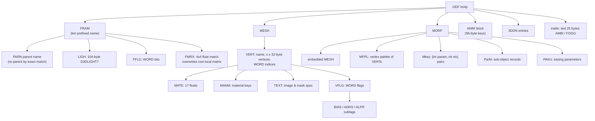

# Part VI: File Format Specifications

Everything the game reads is little-endian, unencrypted, and unpacked - there are no
archives, no checksums, and no compression (see Part III). The parsers are byte-cursor
state machines over a whole-file image, with no universal chunk framing. This part
documents the on-disk layouts; how each format is *consumed* is covered in Parts III-V.
A working Python cross-check exists at `tools/odfParser.py` (the sibling
`xxParser.py` / `sdtParser.py` in the same folder are for other games in this repo,
not HaNaHiMe).

## File Inventory & Identification

| format | dir code | identification | notes |
|--------|----------|----------------|-------|
| `.ODS` | 1002 | SJIS magic + CRLF | scene script container |
| `.ODF` | 1005 | SJIS magic + CRLF | 3D object (frames/meshes/anims) |
| `.sek` | 1005 | fixed size 0x5250 | SEK animation timeline |
| `.STR` | 1004 | none (raw SJIS text) | dialogue script, Part V grammar |
| `.GP` | 1007 | BMP with `bfType` zeroed | event pictures / backgrounds |
| `.BMP` | 1003/1007 | assumed, never validated | 4/8/24-bit |
| `.WAV` | 1006/1009 | RIFF/PCM via mmio | static DirectSound buffers |
| `.AVI` | 1001 (fallback 1000) | MCIWnd | intro / ending |
| `Tea.ex` | 1001 | none | 128-byte graphics config |
| `data0.dat` | 1010 | none | raw `CSystemDataSave`, 256 bytes |
| `data<N>.dat` | 1010 | none | raw `CSceneState`, 400 bytes |

Magic strings (built with `wsprintfA(magic, ..., 13, 10, 0)` and validated with
`lstrcmpA`, so the on-disk prefix is `magic + 0D 0A 00`):

```
.ODS header (14 bytes, "new format" + fullwidth ODS):
  90 56 83 74 83 48 81 5B 83 7D 83 62 83 67 82 6E 82 63 82 72
  -> body starts at file offset 17  (lstrlenA + 1)

.ODF header (24 bytes, "original" + star + "format"):
  83 49 83 8A 83 57 83 69 83 8B 81 99 83 74 83 48 81 5B 83 7D 83 62 83 67
  -> body starts at file offset 27  (lstrlenA + 1)

section terminator (14 bytes, "the file is finished"):
  83 74 83 40 83 43 83 8B 82 CD 8F 49 97 B9        (memcmp, 14)

sound-section marker (8 bytes, "sound"):  83 54 83 45 83 93 83 68   (memcmp, 8)

FRAM attribute-scan end (ASCII, 13 bytes):  "End-Objection"
```

A failed header compare silently ignores the file (for ODF, only the trailer scan still
runs).

## Parsing Model

There is **no `[tag][length][payload]` framing**. Two mechanisms are mixed:

1. **Cursor dispatch + byte scan**: at the cursor the parser `memcmp`s the known tags;
   a match consumes the tag and its handler reads a type-specific payload (ASCIIZ,
   DWORD count, fixed stride). When nothing matches, the cursor advances **one byte**
   and retries until a terminator matches - so unrecognized filler bytes between
   records are legal and skipped, and a payload "ends" exactly where the next
   recognized tag begins.
2. **Bounded subtag windows**: inside records (FRAM attributes, MORP, VERT, the ODF
   trailer) the parser scans forward only 25 or 50 bytes for the subtag 4cc, then
   jumps `subtag + header + payloadSize`. The ODF trailer is special: only the last
   25 bytes of the file are scanned, for `AMBI`/`FOGG`.

String encodings: most names are plain **ASCIIZ** (advance `strlen + 1`). The FRAM
name, PARN parent name, and FMRX matrix use a **DWORD length prefix** (length includes
the NUL, and is the advance). VERT reads a name-length DWORD but advances by
`strlen + 1` anyway (the length is ignored).

## .ODS - Scene Script Container

Loader `LoadOds_4843CF` ([src/ParseODS_483932.cpp](../src/ParseODS_483932.cpp));
`LoadOdsEx_48564B` is the preloaded-frame-reuse variant. Four sequential scan stages:

| tag | layout after the tag | consumed into |
|-----|----------------------|---------------|
| `TEXT` | `[DWORD skipped][ASCIIZ sceneName]` | `szName_160`; the name resolves a `.STR` (dir 1004) loaded whole by `ReadStrFile_483567` (buffer rounded up to 50-byte multiples) |
| `SIZE` | `[DWORD nCount]` | allocates the five parallel scene arrays (`4*nCount` each) |
| `NAME` | `[ASCIIZ odfBaseName]` | loads that `.ODF` (dir 1005) into slot n - frame + animset pair |
| `ANIM` | `[ANIM block]` (below) | keys onto the **previous** NAME's frame, in the scene animset |
| `SEKN` | `[ASCIIZ sekName][DWORD nProps][nProps x {float start; DWORD index}]` | loads the `.sek` (dir 1005) into the previous slot; props table drives rest poses |
| `EYESANIM` | 8-byte tag + `[ANIM block]` | keyed onto `g_pCameraFrame` |
| `EYE2` | **zero-length** marker | first frame whose name contains `eye` becomes the camera eye frame (`pCamFrame_478`) |
| `Light` | `[104B D3DLIGHT7][DWORD skipped][ANIM block]` | light onto `g_pLightFrame` |
| `3DON` | `[DWORD n][n x entries]` | sound emitters (below) |
| terminator | `83 74 ... 97 B9` (or the sound marker / `EYESANIM` between stages) | end |

**3DON entry**: `[float windowStart][float windowEnd][DWORD repeatCap][ASCIIZ wavName][ASCIIZ frameName]`
- the wav (dir 1009) becomes a 3D buffer pinned to the named frame; the floats are the
active time window in the animset clock, the cap limits repeats (negative = unlimited).
Only the first `3DON` of a file is parsed (`nCount_148 == 0` guard).

**ANIM block** (shared by `ANIM`, `EYESANIM`, `Light`):

```
[DWORD nBytes]            // nKeys = nBytes / 56
[nKeys x 56-byte keys]
```

| key offset | size | field |
|-----------|------|-------|
| 0x00 | 4 | float time |
| 0x04 | 12 | position xyz |
| 0x10 | 12 | scale xyz |
| 0x1C | 16 | quaternion xyzw |
| 0x2C | 12 | padding |

All key flags are forced on at load; the set's `fRes_13C` clock length is the max key
time across all anims. `LoadOdsEx` differences: `4*nCount + 64` array slack, NAME
reuses preloaded frames by case-insensitive name match (`_memicmp` incl. NUL), the
light frame gets a random `Light_%d_%d` name, and `3DON` also terminates stage 3.

## .ODF - 3D Object File

Loader `ParseODFFile_441F19` does `SetCurrentDirectoryA` into the ODF's own folder
first, so texture names inside resolve relative to it. Block hierarchy:



Byte layouts:

- **FRAM**: `[DWORD nameLen][name, nameLen bytes incl NUL]`; a frame named
  `CameraFrame` adopts the global camera frame instead of allocating. Attribute scan
  (25 rounds, ends at `End-Objection`): `LIGH` = `[4B skipped][104B D3DLIGHT7]`;
  `FFLG` = `[4B skipped][WORD flags]` - bit0 bone-look-at update, bit1
  hide/alpha-defer, bit2 fog opt-out, bit3 unknown. `FMRX` = `[4B skipped][64B
  matrix]`.
- **D3DLIGHT7 = exactly 104 bytes**: type DWORD @0, diffuse RGBA floats @4, specular
  @20, ambient @36, position @52, direction @64, range @76, falloff @80, attenuation
  0/1/2 @84/88/92, theta @96, phi @100.
- **MESH**: `[DWORD hdrSize unused][DWORD vertCount][ASCIIZ name]`, then `VERT`
  blocks (at least one, even if count is 0).
- **VERT**: `[DWORD nameLen unused][ASCIIZ name][DWORD nVerts][nVerts x 32B
  D3DFVF_VERTEX: pos xyz, normal xyz, tu, tv][DWORD nIdx][nIdx x WORD indices]`,
  then subtag loop `MATE`/`MANM`/`TEXT`/`VFLG`.
- **MATE**: `[DWORD skipped][ASCIIZ name][17 floats: ambient a,r,g,b, diffuse a,r,g,b,
  emissive a,r,g,b, specular a,r,g,b, power]`.
- **MANM**: `[DWORD nKeys][nKeys x 72B: float time + the same 17 floats]`.
- **TEXT**: `[DWORD skipped][ASCIIZ spec]`; spec grammar `"image.bmp & mask.bmp"`
  (mask optional; a trailing `N` after `.bmp` flags a self-blit pre-pass).
- **VFLG**: `[DWORD size][WORD flags]`, cursor jumps `+ size` from the flags, then
  optional `BIAS` `[WORD zBias]`, `ADRS` `[BYTE addrMode][BYTE noPersp]`, `ALPR`
  `[DWORD alphaPriority]`. Flag bits: 0x100 force-alpha-pass, 0x200 blend mode +1,
  0x400 blend mode -1, 0x2000 shadow-only, 0x4000 unlit, 0x8000 glow pass (full table
  in Part IV).
- **MORP**: `[DWORD][DWORD]` unused header, `[ASCIIZ name]`, then an embedded MESH,
  `MPPL` (`[DWORD nVerts]`, n times a `VERT`), per-vertex `Mkey` blocks
  (`[DWORD nKeys][nKeys x {int param; int vtxIndex}]`), `ParM` records
  (`[20B header: 5 DWORDs][ASCIIZ subName][n x 44B` mapping: source vertex, frame,
  weight, position, normal, padding`]`), and `PAKU`
  (`[DWORD easeEnabled][DWORD easeFrom][DWORD easeTo][DWORD timeState][DWORD
  timeFrom][DWORD timeTo][DWORD easeRate unless next 4 bytes are "Mani"]`).
- **3DON** (ODF variant): same entry layout as ODS, but the wav name is used
  cwd-relative (the ODF's own folder), not through the dir codes.
- **Trailer**: `AMBI` `[DWORD 0x00RRGGBB]` ambient light on the root frame;
  `FOGG` `[DWORD color][float start][float end]` frame fog, propagated to children.

## .sek - SEK Timeline

Every `.sek` on disk is exactly **0x5250 bytes**; the loader blindly reads
`0x100 + 0x100 + 0x5054` and ignores the short count (the final DWORD, the runtime
refcount, is never on disk):

| offset | size | content |
|--------|------|---------|
| 0x0000 | 0x100 | ASCII source path from the developer's machine (NUL-padded) - read and discarded |
| 0x0100 | 0x100 | associated `.ODF` filename only - read and discarded (binding is positional, see below) |
| 0x0200 | 0x5050 | raw `CSekBody` image (the struct's last field, the refcount, excluded) |

`CSekBody` image: two 256-byte name fields, current-item / requested-item ints,
three ints (loaded then immediately re-zeroed, no semantics found), blend request
and weight floats, a runtime pointer slot, gap, loop/step/disable flags, then
**128 items of 0x9C bytes**. `CSekItem` field map:

| offset | type | field | meaning |
|--------|------|-------|---------|
| 0x00 | int | mode | 0 = one-shot, 1 = loop |
| 0x04 | char[64] | name | authoring label (`stand`, `walk`), never read at runtime |
| 0x44 | int | curStep | current step (saved mid-value on disk) |
| 0x48 | int | loopStartStep | step restored on loop wrap |
| 0x50 | int | endStep | total steps - play-rate divisor |
| 0x54 | float | startTime | anim window start |
| 0x58 | float | endTime | anim window end |
| 0x5C | float | playRate | 1.0 on disk; recomputed `(end-start)/endStep` on play |
| 0x60 | float | curTime | current time (saved authoring state; runtime advances) |
| 0x64 | int | loopCount | loop wrap counter |
| 0x70 | int | autoNext | gates completion chaining and the loop limit |
| 0x74 | int | nextItem | item index chained to on end |
| 0x78 | int | maxLoops | loop limit before chaining |
| 0x7C | int | noBlend | 1 = hard cut on entry (no crossfade) |

Binding is **positional, not by name**: the ODS `SEKN` slot wires the body's header
to the frame/animset pair loaded by the preceding `NAME` tag at the same array index;
the embedded ODF filename in block 2 is never consulted. At runtime
`CSekBody__UpdateAnim_4019E1` advances `curTime += delta * playRate`; on window end a
one-shot either parks (no autoNext) or chains to `nextItem`, a looping item restarts
at `loopStartStep` until `maxLoops`, and crossfades ride the `fBlendReq/fBlendWeight`
pair (Part III).

## .STR, BMP/.GP, WAV, AVI

- **`.STR`**: raw Shift-JIS with `;` `*` `,` delimiters; command grammar in Part V.
  Loaded whole into `ptrStrData_260`; the only buffer in the game whose size is
  data-dependent.
- **`.GP`**: a standard BMP whose `bfType` is zeroed - `00 00` then a normal
  `BITMAPFILEHEADER` (bfSize = real file size) + 40-byte `BITMAPINFOHEADER` (samples
  are 1024x768x24) + pixel data. `LoadBmp_420DF0` never checks `bfType`, so `.GP`
  loads through the plain BMP path.
- **`.BMP`**: no magic or compression validation; the parser assumes a 14-byte file
  header + 40-byte info header, supports 4/8-bit palettes (`biClrUsed` entries, else
  `1 << bitCount`) and 24-bit native; on 16-bit display modes, 24-bit art is dithered
  to RGB565 with the 8x8 Bayer matrix.
- **`.WAV`**: RIFF walked with mmio; `fmt ` must be at least 18 bytes and
  `WAVE_FORMAT_PCM` - any PCM DirectSound accepts (8/16-bit, mono/stereo) passes.
  Everything is a static, whole-sample buffer.
- **`.AVI`**: played through an MCIWnd child (IV50 codec - hence the Xvid re-encode
  recipe in the README).

## Tea.ex

128 bytes, no magic. The buffer is 32 dwords; only indices 0-8 are meaningful
(0 fog, 1 specular, 2 antialias, 3 dither, 4 light, 5 shadow, 6 resolution mode,
7 z-depth mode, 8 HAL device - forced to 1 after load); bytes 9-127 are reserved
zeros preserved across rewrites. See Part IV for what each flag does.

## data0.dat / data<N>.dat

`data0.dat` is a raw `CSystemDataSave` (0x100 = 256 bytes):

| offset | size | field |
|--------|------|-------|
| 0x00 | 50 | per-book/story flags (set by `GETBOOK`) |
| 0x32 | 150 | CG gallery unlock bytes, indexed by GP number |
| 0xC8 | 40 | collected-item bits (10 x int) |
| 0xF0 | 4 | unlocked save-slot bitmask (bits unlock diary slots 7-10) |
| 0xF4 | 1 | scene background flag |
| 0xF5 | 1 | scene "male" effect level 0-4 |
| 0xF6 | 1 | volume level (index into the dB ladder) |
| 0xF7 | 1 | text speed |
| 0xF8 | 1 | first-person camera toggle |
| 0xF9 | 1 | progress flag (0 fresh / 1 backdrop seen / 2 ending seen) |
| 0xFA | 6 | padding |

`data1..10.dat` are raw `CSceneState` images (0x190 = 400 bytes): scene step byte @0,
sub-stage @1, scene data indices @4, the 100-byte `ary33` trigger bitfield @0x33,
max sub-stage @0x97, item bits (5 x QWORD) @0x98, heroine HP floats @0xC0/0xC4,
selection mask @0xC8, and floats @0x17C/0x180/0x188/0x18C - note the @0x184 field is a
live DirectDraw *pointer* serialized raw, meaningless on disk and simply overwritten
on load.

## Asset Directory Map

| dir | contents |
|-----|----------|
| ODS (1002) | `mapXX.ods` scene scripts, `act` blocks |
| SPR (1003) | `mouse.bmp`, `Darken.BMP`, `window1..7.bmp` (dialogue windows), `YesNo1/2.bmp`, mode/hunt indicator strips, run buttons |
| Str (1004) | dialogue `.STR` text |
| ODF (1005) | `map\mXX\atXX.ODF` objects, `item\i11..i17` pairs, `*.sek` timelines |
| WAV (1006) | `s001..s014.wav` BGM |
| GRP (1007) | `Title.bmp`/`TitleBt.bmp`, `war.bmp`, `Wait.bmp`, `Systembk.bmp`, `System01..06/31..35.bmp`, `DD*.bmp` launcher art, `gl*.bmp` gallery, `G00.GP..G48.GP` event CG, `gov.gp` ending backdrop |
| GRP800 (1008) | exists in path code only - no loader references it |
| SE (1009) | UI wavs (`door`, `On`, `click`...), `foot1/2/3/5.wav`, voice wavs |
| DATA (1010) | `data0.dat` autosave, `data1..10.dat` diary slots, timestamps |
