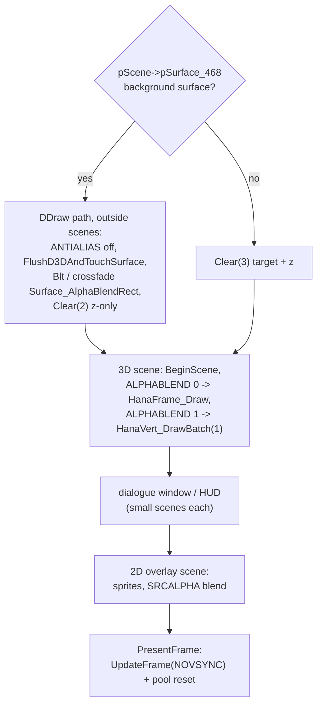
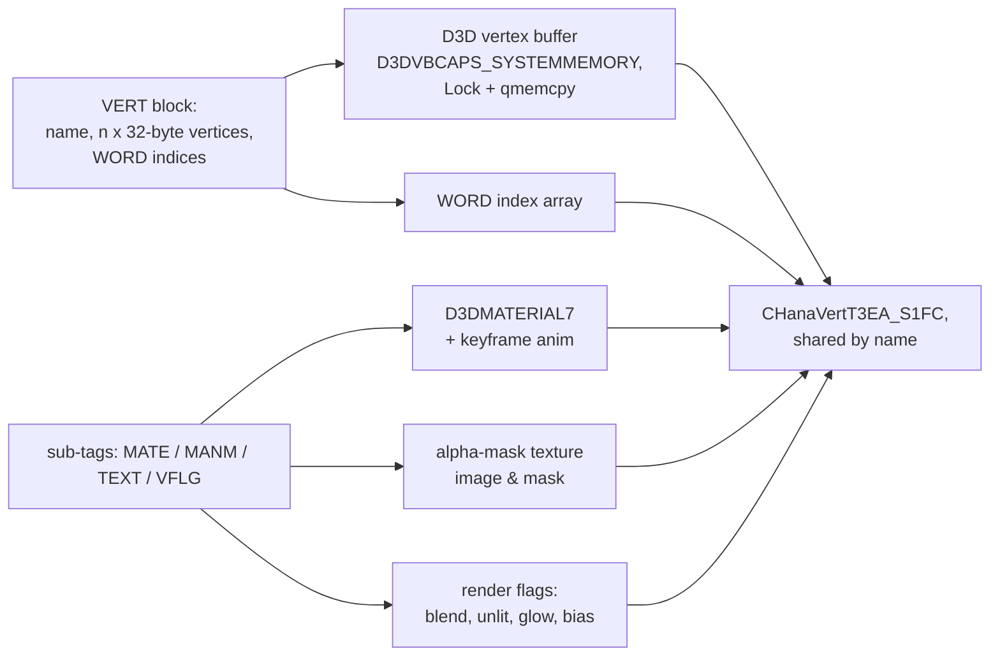
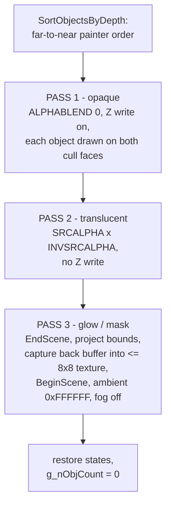

# Part IV: Rendering & Pipeline Graphics

Immediate-mode DirectX 7 fixed-function rendering through the D3DX context
(`g_pRenderCtx`). There is no render graph, no command queue, and no state cache -
every pipeline stage is explicit `SetRenderState` / `SetTextureStageState` churn at its
call site, re-established per frame because menus, fades, and blits constantly toggle
states off.

## Renderer Abstraction

### The two state baselines

- `D3DInitBuffers_40AF60` ([src/CheckRunGame_4863C8.cpp](../src/CheckRunGame_4863C8.cpp))
  runs once per device creation and sets the full fixed-function baseline:
  `TEXTUREPERSPECTIVE=1`, `CLIPPING=1`, `ANTIALIAS=2`, `ZENABLE=1`, `DITHERENABLE=1`,
  `CULLMODE=3` (none), `ALPHABLENDENABLE=1` with `SRCBLEND=SRCALPHA` /
  `DESTBLEND=INVSRCALPHA`, stage-0 alpha `TEXTURE x DIFFUSE, MODULATE`,
  `COLORKEYENABLE=1`, `COLORVERTEX=1`, specular on, plus the default material, the
  scene/camera/light frames, and a 0.5-gray ambient pseudo-light.
- `D3DSetRenderStates_4276C0` ([src/ShowTitleMenu.cpp](../src/ShowTitleMenu.cpp))
  re-applies only the `Tea.ex`-driven quality subset (`SHADEMODE` gouraud, `LIGHTING`,
  `SPECULARENABLE`, `ANTIALIAS=SORTINDEPENDENT` with fallback, linear filters,
  `DITHERENABLE`) and is re-invoked at every return to scene rendering
  (after the title menu, after menus, after each chapter step) because AVI playback,
  backdrops, background blits, and fades all save/restore `ANTIALIAS` around their
  DirectDraw work. It also derives `g_bForceDirectionalLights` from
  `dwVertexProcessingCaps`.

### Scene discipline - many small scenes per frame

There is not one big scene. A canonical frame is:

1. DirectDraw background work **outside any scene** (see below), bracketed by
   `FlushD3DAndTouchSurface_43BF6F` - a degenerate `DrawPrimitive(TRIANGLEFAN)`
   followed by a `Lock`/`Unlock`, forcing the driver to flush queued D3D work so the
   subsequent blits see a coherent back buffer.
2. **3D scene**: `BeginScene` -> `ALPHABLENDENABLE=0` -> `HanaFrame_Draw(g_pSceneFrame)`
   (opaque, direct) -> `ALPHABLENDENABLE=1` -> `HanaVert_DrawBatch(1)` (transparent,
   pooled) -> `EndScene`.
3. Dialogue window / HUD draws, each in their own small scenes.
4. **2D overlay scene**: `BeginScene` -> sprite quads (cursor, gauges) -> `EndScene`.
5. `PresentFrame` = `g_pRenderCtx->UpdateFrame(D3DX_UPDATE_NOVSYNC)`, with
   `RecoverLostDevice` on surface loss, then `HanaVert_DrawBatch(0)` resets the pool.

The glow pass breaks *into* the middle of a scene: `UpdateVertTextureFromFrame_439D48`
issues its own `EndScene`, captures the back buffer, then re-`BeginScene`s.

### The two render paths

Scene loops branch on `pScene->pSurface_468` (a still-image background):

- **Background-surface path**: `ANTIALIAS` off, `FlushD3DAndTouchSurface`, `Blt` the
  image to the back buffer - during a background change, `Surface_AlphaBlendRect_41A039`
  crossfades from the old image (`pUnk_47C`) with alpha stepping at
  `fFrameTime/25` - then `Clear(2)`: **z-buffer only**, the target already holds the
  image. `Surface_AlphaBlendRect` is a manual per-pixel loop (integer percent 0-100,
  per-channel with `g_dwRBitMask`/`g_dwGBitMask`, depth-dispatched 16/24/32, optional
  color-key skip) - not DDBLT alpha.
- **3D path**: `Clear(3)` (target + z) and draw the frame tree.

### The 2D sprite layer

Sprites (`CHanaSpriteT3F6`) are D3D textured quads through the vendored D3DX runtime:
`D3DXDrawSpriteSimple` (screen-space, pinned @0x4900CA) and `D3DXDrawSprite3D`
(arbitrary quad, pinned @0x4902CF). The four wrappers differ in churn only:
`DrawSprite2D_414191` (own size), `DrawSpriteAtRect_4147ED` / `DrawSpriteLTRB_414589`
(stretched rect, stage-1 disabled), `DrawSprite3D_414344` (free quad + default
material). All set stage-0 alpha/color MODULATE, toggle `LIGHTING`/fog off and back,
and rely on the baseline `SRCALPHA x INVSRCALPHA` blend; glow effects switch
`DESTBLEND=2` (additive). All screen-space coordinates go through the
`ConvertFrom640AsInt/AsFloat` / `ConvertFrom1024AsInt/AsFloat` hooks
([src/GameMainLoop_47F013.cpp](../src/GameMainLoop_47F013.cpp)) - authored 640x480 /
1024-space values scaled linearly by `g_nWidth3` (the render width, @0x52F19C).

## Asset & Geometry Pipeline

### ODF mesh parsing

`ParseOdfMESH_44068C` ([src/ParseODFContent_441A5D.cpp](../src/ParseODFContent_441A5D.cpp))
walks `MESH -> VERT` blocks. Each `VERT` block is
`[name][DWORD nVerts][nVerts x 32 bytes][DWORD nIndices][nIndices x WORD]`:

- The vertex format is hardcoded **`D3DFVF_VERTEX` (0x112)**: position + normal + one
  UV set = 12 + 12 + 8 = the 32-byte stride the parser advances implicitly.
  `CHanaObj__NewVertT3EA` creates a `LPDIRECT3DVERTEXBUFFER7` with
  `dwCaps = D3DVBCAPS_SYSTEMMEMORY` (0x800) via `g_pD3D->CreateVertexBuffer`;
  `CHanaObj__FillVertexBufferT3EA` `Lock`s it (`DDLOCK_WAIT`) and `qmemcpy`s the raw
  bytes; indices are copied into a plain `WORD*` array (`MemAlloc(2*n+128)`).
- Vertices are **shared by name**: `GetVertByName_4400C3` reuses an equal-sized vert
  object, retrying with a `"name(n)"` suffix on mismatch; unnamed verts get names
  printed from three `rand()` calls.
- `nPrimType_154[1]` selects the primitive: `0` indexed TRIANGLELIST (the only path
  the rebuild ever sets), `1` TRIANGLESTRIP, else TRIANGLEFAN. `[0]` is the
  pooled-skip handshake flag used by the batch.

### Per-vertex render flags - the VFLG tag

`ParseOdfMeshVFLG_43FDEC` maps WORD bits onto `CHanaVertT3EA` fields:

| bit / tag | field | effect |
|-----------|-------|--------|
| 0x100 | `bForceAlphaPass_1CC` | draw only on the unculled iteration |
| 0x200 | `nBlendMode_1D0 = 1` | additive blend (`SRCALPHA x ONE`) |
| 0x400 | `nBlendMode_1D0 = -1` | inverse blend (`ZERO x INVSRCCOLOR`) |
| 0x2000 | `bShadowOnly_1E0` | skip entirely when shadows are off |
| 0x4000 | `bUnlit_1E4` | `COLOROP = SELECTARG1` (texture only) |
| 0x8000 | `bAlphaPass2_1E8` | route to the pass-3 glow |
| `BIAS` | `nZBias_1EC` | `D3DRENDERSTATE_ZBIAS` (WORD, 0-65535) |
| `ADRS` | `nTexAddrMode_1F8`, `bNoTexPersp_1F4` | texture ADDRESS mode (wrap/mirror/clamp) |
| `ALPR` | `nAlphaPriority_1F8` | draw-order bias, 1000 depth units per step |

### Materials

`MATE` is 17 floats straight into `D3DMATERIAL7` (ambient, diffuse, emissive,
specular RGBA + power). `HanaMate_SetMaterial_40FB30` clamps `diffuse.a` to [0,1] and
zeroes specular when `g_bSpecularEnable_4B00A0` is off; `ApplyMaterial_40F891` sets the
values + `fMatDirty`. Material *animation* (`MANM` keys) lerps diffuse/emissive/
specular RGB and diffuse alpha between sorted keyframes each anim tick, with ambient
forced to 1.0.

### Textures

`TEXT` specs are `"image.bmp & mask.bmp"` strings; the mask's RGB average becomes
per-pixel alpha (see Part III). Address modes come from `ADRS`; filters switch to point
sampling only for font-glyph baking and the glow capture, linear elsewhere.

### Morphs

`MORP` embeds a full MESH plus a `MPPL` vertex palette, `Mkey` arrays, `ParM`
sub-object bindings, and `PAKU` easing. At draw-prep time the sub-objects copy/lerp
source vertices into the target (`HanaVert_CopyMorph` / weight-blended
`HanaVert_LerpMorph`) - this is the game's "skinning": rigid frame transforms plus
per-vertex morph blending, no bone-weight vertex skinning.

## Lighting, Post-Processing & Pipelines

### Lights

- Slot allocation is an inline first-free-bit scan over the 64-bit mask
  `g_bitsLightIndexes_4D6CB8` - but D3D7 honors only 16 hardware lights, so
  `SetLightEnableMask` (pinned @0x40CE4E) loops all 64 `LightEnable` calls knowing bits 16+ are
  no-ops. Freeing a light has a faithfully preserved bug: the mask-clear expression is
  always false, so freed slots are never reclaimed in the mask.
- `ConfigureLight` feeds every caller the same way: position = the frame's
  `matWorld_178` row 4, direction = its Z column (X/Y negated for directional/spot).
  `D3DLIGHTTYPE == -1` is a **pseudo-type meaning ambient**: `ApplyLightSettings`
  writes `D3DRENDERSTATE_AMBIENT` instead of calling `SetLight`, and the traversal
  recurses children under that ambient. A device without directional-light transform
  support (`g_bForceDirectionalLights`) degrades every light to directional.
- Per-pooled-object lighting is snapshotted: each `CObjPoolMgr_S58` entry carries the
  ambient color and the 64-bit light mask in effect when it was pooled, replayed
  per object during the batch.

### Fog and shadows

Fog is linear **table fog** (`SetFogMode_40E02D(TRUE, D3DFOG_LINEAR)`, range 5.0-250.0,
black, set from `OnEngineInit` via `SetFogEnable_40DFB0`), applied per scene child from
the frame's `bHasFog/dwFogColor/fFogStart/fFogEnd` and per pooled object in the batch;
`bDisableFog_134` (FFLG bit 2) opts a frame out.

Shadows are honest simplicity: **there is no shadow pass**. `bShadowOnly_1E0` flags
pre-authored dark mesh patches that either draw normally (shadows on) or are skipped
(`g_dwShadowOff`, derived from the Tea.ex shadow option). No shadow map, no projection,
no second pass.

### The three-pass draw batch

`HanaVert_DrawBatch(1)` (after `SortObjectsByDepth`, see Part III) renders the pool:

The pass-3 capture is the environment/glow trick: project the object's bounding rect
to screen, blit that region of the back buffer into a tiny texture (column-mirrored),
and draw the object with it - point filtering, full ambient, no lights.

### Fades and screen effects

- `PlayScreenFade_4874DE` ([src/PlayScreenFade.cpp](../src/PlayScreenFade.cpp), 24
  call sites) is a two-pass sprite overlay, not DDBLTFX: a solid color sprite drawn
  `DESTBLEND=INVSRCALPHA` then additive (`DESTBLEND=ONE`) over a captured pre-fade
  frame, alpha stepping with the scaled frame timer (which is why fades set
  `SetTimerScaleFactor` for their duration). Colors range from black/white flashes to
  the red death flash and script-driven `GO,R,G,B_<t>` fades.
- The **wwave shimmer** (death effect, recently fixed): a 128x128 sprite whose texture
  is reloaded from the *primary surface* every frame, drawn as a wobbled full-screen
  quad - `D3DXVECTOR3 vtxQuadWave[4]` corners advancing on sin/cos phases. The fix
  replaced mis-declared scattered locals (with an int Z) by the proper 4-vector array.
- `DrawFadeOutSpark_45669F`: three horizontally dissipating additive copies;
  `DrawSpriteListEcho_45B2FB`: ghost-trail echoes at 0.3 alpha, additive.

### Z-buffer

16/24/32-bit depth is tried in order at device creation (the Tea.ex z-depth mode picks
the starting candidate); the game uses plain z-buffering - no w-buffering anywhere.
`ZENABLE/ZWRITEENABLE/ZVISIBLE` are always toggled as a triple (off for all 2D and fade
work, write-off for translucent pass 2), and `nZBias_1EC` feeds
`D3DRENDERSTATE_ZBIAS` per vertex.

### Tea.ex graphics options

Read at boot in `CheckRunGame_4863C8`, edited in the launcher and in-game Graphics
tab, written back on exit; re-applied by `D3DSetRenderStates_4276C0`:

| idx | global | default | effect |
|-----|--------|---------|--------|
| 0 | `g_bFogIsActive_4B3480` | on | fog enable + linear range |
| 1 | `g_bSpecularEnable_4B3474` | on | `SPECULARENABLE` |
| 2 | `g_bAntiAliasEnable` | off | `ANTIALIAS=SORTINDEPENDENT` (fallback off) |
| 3 | `g_bDitherEnable` | on | `DITHERENABLE` |
| 4 | `g_bLightEnable_4B3484` | on | `g_nLightningEnabled` master gate |
| 5 | `g_bShadowEnable_518CA8` | off | `g_dwShadowOff` (skip shadow-only geometry) |
| 6 | `g_nResolutionMode_518C80` | - | video mode index |
| 7 | `g_nZBufDepthMode_518C9C` | - | z-depth candidate order |
| 8 | `g_nRenderHALMode_518CA0` | forced 1 | device index for `D3DXCreateContextEx` |
