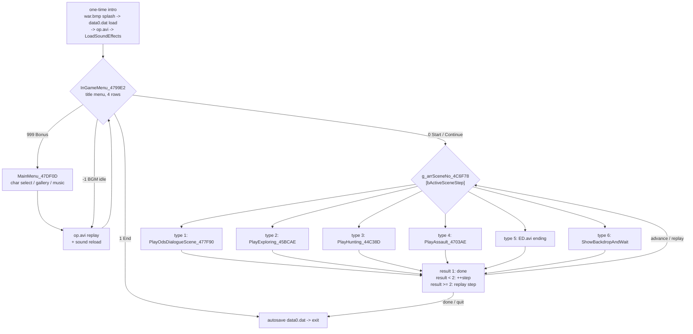
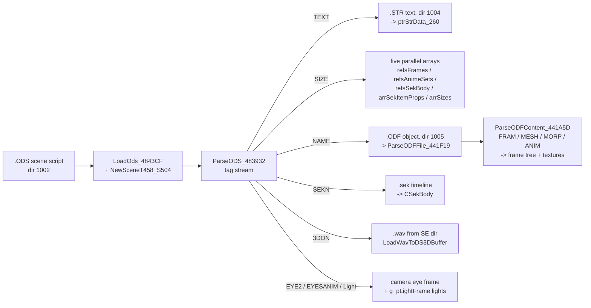
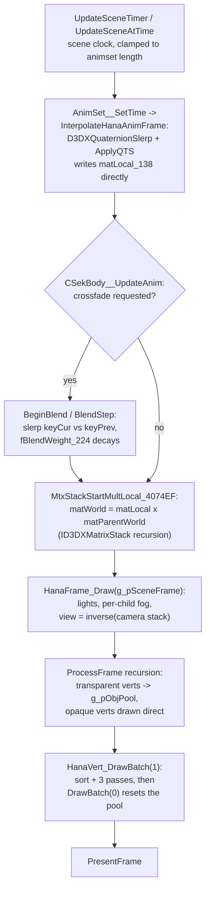

# Part III: Core Runtime Systems

## The Main Game Loop

### The outer loop - GameMainLoop_47F013

[src/GameMainLoop_47F013.cpp](../src/GameMainLoop_47F013.cpp) runs the whole game after boot:

- **One-time intro**: `war.bmp` splash blitted straight to the primary surface, sound-table
  resets, `g_sysDataSave_530170` defaults, `data0.dat` load (1010), then `op.avi`. There is
  **no first-boot flag** - the intro plays unconditionally on every launch.
- **Menu sub-loop**: `InGameMenu_4799E2` is the 4-row title menu (Start / Continue / Bonus /
  End). Its return value drives everything: `0` start or continue, `1` quit, `999` bonus
  (run `MainMenu_47DF0D`, then force `-1`), `-1` idle (BGM ended) - both `-1` paths replay
  `op.avi` and loop back to the menu.
- **Chapter walk**: `g_sceneState_52F7E0.bActiveSceneStep` indexes the compiled-in chapter
  table `g_arrSceneNo_4C6F78[100]` (`{nSceneType, nStrIndex}` pairs; [1..82] live).
  The scene-function result protocol: `1` chapter finished, `< 2` (0 or -1) advance the
  step, `>= 2` replay the same step (the scene itself already moved `bActiveSceneStep` -
  this is the in-scene load path).
- **Autosave**: after the chapter walk (and on quit), `data0.dat` is written back - guarded
  by a vestigial format string that is always empty, so the save effectively always happens.
- **Type 6 backdrop**: `ShowBackdropAndWait_4795CE` - loads `gov.gp` + `s014.wav`, fades,
  pumps messages until click / sound end / 500 frames.

### The per-scene frame loop

Every scene player runs the same skeleton (input and timing primitives are covered in
Part II):

1. `DoPeekMessages()` - message flush.
2. Scene-local `timeGetTime` clock + `GetFrameTime` delta, clamped at 5.0 s,
   `FrameTimer_EndFrame()`.
3. ESC via `IsMenuKeyPressed_481170` -> pause through `SystemMenu_4655AB` (the scene
   snapshots and restores `g_sceneState` around it).
4. Mouse read (`GetMouseBtn_45A41B` edge detect, `GetMouseXY_45A4D8`).
5. Scene update: `UpdateSceneTimer_4827FE` + `UpdateSceneAtTime_4825D5` (animation clock)
   and `ParseExecStr_487D89` (script interpreter).
6. Render: background surface path or 3D path, then `PresentFrame` +
   `HanaVert_DrawBatch(0)`.

Per-scene variations worth knowing:

- **PlayOdsDialogueScene** (dialogue): skip mode on middle-click, right button x5 speed,
  left-click x1000 text rush; exits 0 when the scene script finishes.
- **PlayExploring** (map roam): `UpdateHeroControl_45A513` + camera chase + lock-on; the
  countdown clock is frozen while dialogue runs; `CheckSceneTransition_459768` handles
  exits; defeat offers retry (heal +15%) or quit.
- **PlayHunting** (duel): a 3-minute round clock, foe AI, four wana attack types,
  cinematic cut-ins via `PlayTugOfWar_45460A` - and the delta is divided by 4 while a
  cinematic is queued (the game's slow-motion effect). The round continues past zero HP
  while a finisher animation (items 16/10/11/13) is playing.

**Scene return protocol** everywhere: `-1` load failure, `0` normal finish, `1` quit to
menu, `2` replay/load in place.

### Menus

- `InGameMenu_4799E2` ([src/InGameMenu_4799E2.cpp](../src/InGameMenu_4799E2.cpp)):
  hit-test rows over `Title.bmp`/`TitleBt.bmp`; row 2 (Bonus) is locked while
  `g_sceneProgressFlag_530269 == 0`; a Continue that loads a save hands control back with
  return 0 and the loaded `bActiveSceneStep` already in place.
- `SystemMenu_4655AB` ([src/SystemMenu_4655AB.cpp](../src/SystemMenu_4655AB.cpp)): the
  shared pause shell with 7 tabs (save, load, girl status, options, graphics, back,
  quit). Save slots are 10 diary slots (`data<N>.dat`, 400-byte `CSceneState` images);
  slots 7-10 are gated by `g_dwUnlockedSaveSlots_530260` bits; the diary text block is
  picked with `g_arrSceneStepThresholds_4B5970` - the only consumer of that table. The
  Graphics tab persists `Tea.ex`.
- `g_bRunGame` (@0x4B3488) is set by the launcher title menu (`WndProcTitleMenu`) and is
  the flag that ultimately ends `WinMain`'s pump.

## Resource Management & Asset Loading

### Path resolution - no registry, no INI

`CheckInstalledDirRoot_4869A7` scans drive letters `A:`..`Z:` (skipping unknown/removable
drives) for two marker files: `HDFILE` under the install dir and `CDFILE` on the data CD.
Each marker is 17 bytes built at runtime via `wsprintfA`, so the magic bytes never appear
contiguously in the binary. On success it sets `g_szHnhPath_530270` (install root) and
`g_szDriveLetr_52FC70` (CD root, may stay empty) and calls `SetupDirPath_486630`, which
maps each asset directory - ODS, SPR, Str, ODF, WAV, GRP, GRP800, SE - to the install dir
**or falls back to the CD per-directory**; DATA is `CreateDirectoryA`'d if absent.

`CHanaObj__GetRealPath_486D9A` prepends the directory in place:

| code | directory |
|------|-----------|
| 1000 | CD root (AVI fallback, disc check) |
| 1001 | install root (`HaNaHiMe.exe`, `Tea.ex`, `op.avi`) |
| 1002 | ODS (scene scripts) |
| 1003 | SPR (plain `.bmp` sprites - there is no `.SPR` file format) |
| 1004 | Str (dialogue text) |
| 1005 | ODF (3D objects, `.sek` timelines) |
| 1006 | WAV (BGM) |
| 1007 | GRP (event pictures, backgrounds) |
| 1008 | GRP800 (exists in the path code; no caller in the rebuilt sources) |
| 1009 | SE (sound-effect `.wav`) |
| 1010 | DATA (saves) |

### File I/O

Three thin helpers and **no caching layer whatsoever** - every loader re-opens its file:
`ReadFileToBuffer` (`CreateFileA`/`GetFileSize`/`ReadFile`), `WriteBufferToFile`
(`CREATE_ALWAYS`, no error checking), `IsFileExists_47E8EE` (`FindFirstFileA` probe).
Audio goes through `mmio`; video through MCI.

### Format map

| format | loader | produces |
|--------|--------|----------|
| `.ODS` | `LoadOds_4843CF` -> `ParseODS_483932` | `CHanaSceneT458_S504` |
| `.ODF` | `ParseODFFile_441F19` -> `ParseODFContent_441A5D` | frame tree, meshes, morphs, anims, textures |
| `.sek` | `ParseSekFile_401039` | `CSekBody` timeline (fixed 0x5254-byte read) |
| `.STR` | `ReadStrFile_483567` | raw Shift-JIS buffer `ptrStrData_260` |
| `.BMP` | `LoadBmp_420DF0` / `GetSurfaceFromBmp_419DE5` / `LoadBmpScaled_4203B3` | DirectDraw surfaces |
| `.GP` | `LoadBmpScaled_4203B3` | just BMP files with a renamed extension |
| `.WAV` | `LoadWav_422E7B` (2D) / `LoadWavToDS3DBuffer_42277E` (3D) | DirectSound buffers |
| `.AVI` | `PlayVideoWith3DAudio_4791A3` | MCIWnd child window (dir 1001, fallback 1000) |
| `data0.dat` | `ReadFileToBuffer` / `WriteBufferToFile` | `g_sysDataSave_530170` (autosave) |
| `data<N>.dat` | `LoadDataFiles_461557` / `SystemMenu` | 400-byte `CSceneState` slots |
| `Tea.ex` | `CheckRunGame_4863C8` / `SystemMenu` | 128-byte graphics config |

There are **no archives, packing, checksums, or encryption** - confirmed by enumerating
every `CreateFileA`/`mmioOpenA` site; the only `SetFilePointer` in the codebase is the
raw-CD sector read for the disc check. The ODS/ODF parsers are magic-string driven
(Shift-JIS headers, ASCII tags). `ParseODFFile_441F19` even does a
`SetCurrentDirectoryA` into the ODF's folder so texture paths inside the file resolve
relative to it.

How an `.ODS` scene assembles its resources:

`LoadOdsEx_48564B` is the variant that reuses an already-loaded scene's frames and
animsets by name match instead of re-parsing.

### Textures

- `GetSurfaceFromBmp_419DE5` parses `BITMAPFILEHEADER` directly; on 16-bit display modes
  it dithers 24-bit BMPs down with the 8x8 Bayer matrix
  (`BMP_Convert24bitTo16bitWithDither_421FF4`), then `StretchDIBits` into a fresh
  DirectDraw surface.
- `CreateTextureFromSurfaceWithAlphaMask_43EA05` is the core composer: it creates two
  D3DX textures (image + grayscale mask), locks both, and writes per-pixel
  alpha = average(mask RGB). ODF texture specs are `"image.bmp & mask.bmp"` strings; the
  split name is also the registry key. Color keys are used only for 2D menu blits -
  3D transparency is always the alpha-mask path.
- **Texture dedupe is the only cache**: `FindObjByType_40BC13(name, 0x3EB)` looks a
  texture up by its spec string before loading (`ParseOdfMeshTEXT`). Everything else -
  BMPs, sounds, sprites - reloads per call; the footstep `.wav`s are even loaded twice
  on purpose (two 3D buffer sets).

### Caching and unloading

Object lifetimes ride the Part II refcount system. Scenes are the unit of teardown:
`CHanaObj__FreeSceneT458_4821FA` releases the background/sound surfaces, window sprites,
the 4x29 glyph grid, the animset, and cascades `CHanaObj__Free` through the frame arrays
and `CSekBody__Release_4012FE` through the timelines. One live scene per player function
(`LoadOds` callers free the previous scene first).

## Scene Graph & Entity Management

### The three global frames

Created in `D3DInitBuffers_40AF60`: `g_pSceneFrame` (a `CHanaFrameRootT3EC_S2D4`, the
world root), plus `g_pCameraFrame` and `g_pLightFrame` (`CHanaFrameT3EC_S354` children,
registered by name). A frame created with a NULL parent auto-attaches to `g_pSceneFrame`.
The camera is special-cased during traversal: when the recursion reaches it, the view
matrix is set to the inverse of the current stack top (`SetInversTransf_405BB4` writing
`g_mat4x4View_4D4780`) and its children are not traversed. The viewport matrix `g_pM2`
(@0x4CE918, from `BuildViewportMatrix_40E167`) exists only to feed
`ProjectToScreen_40E2A5` (`world x view x projection x viewport`).

### Per-frame update order

The canonical pipeline (details of the draw calls are Part IV):

Key points:

- **Animation writes local matrices** - `InterpolateHanaAnimFrame_40283C` slerps the
  quaternion keys and composes `ApplyQTS_4035B1` straight into
  `pHanaFram_130->matLocal_138`, before any matrix-stack pass.
- **Crossfade blending** (`CSekBody__UpdateAnim_4019E1` with `fBlendReq_21C`):
  `BeginBlend_43A371` snapshots `keyCur_14C -> keyPrev_1C4`, then `BlendStep_43A643`
  slerps between them while `fBlendWeight_224` decays - `HanaAnim_UpdateBoneTransform_43A43F`
  is the per-bone slerp site.
- **Morph controllers** run inside `HanaFrame_Draw` prep (`HanaFrame_PreDraw_4339B2`,
  two passes): `HanaMorpT457_Animate` supports three parameter modes - direct set,
  eased interpolation (`dwEaseEnabled_358`, `fEaseRate_388`), and wall-clock tween - plus
  a sound-driven mode where the mouth-flap parameter follows the voice buffer's average
  level.
- `MtxStackStartMultLocal_4074EF` is called explicitly by every scene loop right before
  rendering (and by `AttachChild`/loaders); `HanaFrame_Draw` also rebuilds the stack
  internally.

### No culling

There is no frustum or distance culling anywhere. The render gate in `ProcessFrame` is
just `!bAlphaDeferred_130 && g_bCurFrameIsScene && !g_bRendering`. `bAlphaDeferred_130`
doubles as a hide flag (set on the hero during the overhead duel camera). Frame bounds
(`vertBoundMin/Max`, `vertCenter_2B4`, `vertMagnitude_2B0`, world AABBs) exist for
**collision** and the glow-pass screen capture, not visibility. The 6000-entry draw-batch
clamp is the only "too much geometry" guard.

### Draw-batch sort

`SortObjectsByDepth_40D9C7` is an O(n^2) exchange sort (not qsort) over the pool entries.
Sort key: camera-space Z of the frame's `vertCenter_2B4` minus `1000 x nAlphaPriority_1F8`
per priority level, ordered far-to-near (painter's order); the priority bias lets authors
force draw order. The batch then renders in three passes - opaque, translucent
(`SRCALPHA`/`INVSRCALPHA`, no Z write), and glow (back-buffer capture into the object's
texture) - covered in Part IV.

### Scene lifecycle and state

- `CHanaObj__NewSceneT458_S504` allocates the scene, its master animset, the five
  dialogue-window sprites, and the 4x29 text-sprite grid. `LoadOds_4843CF` /
  `LoadOdsEx_48564B` are the only creators; each scene player frees the previous scene.
- `g_sceneState_52F7E0` (`CSceneState`, 0x190) carries the playthrough: `bActiveSceneStep`
  (the chapter index - there is no separate "current scene" global), `sceneItemBits_98`,
  the heroine HP pair `protCurrentHP_C0` / `protMaximumHP_C4` (default 66600.0),
  `qwSelMask_C8` (assault selection). `frameTimeMultiplied_180` is not a clock - it is a
  by-value argument carrier that each scene reuses differently (text rush delta, text
  speed, effect intensity). Real slow motion is just `SetTimerScaleFactor`.
- The save-slot image on disk is exactly this struct (400 bytes), read/written whole.

### Camera and hero

- The camera is slaved to an "eye" bone: `EYE2` finds a frame named `*eye*` in the scene
  (renaming it `XXXX` so later lookups skip it) and records `pCamFrame_478`; per frame
  the global camera copies the eye frame's orientation
  (`CalculateLocalRotationMatrix_407047`) and position. `EYESANIM` binds an animation
  track directly to `g_pCameraFrame`. `UpdateCameraLinkedObjects_44451F` strips stale
  anims still bound to the camera after an ODS load by walking the object table for
  type `0x3F1`.
- First-person view (`g_nFirstPersonCam_530268`, toggled with the `C` key) switches
  PlayHunting between `UpdateCameraFollowDuel_44C028` (overhead duel camera, hero hidden
  via `bAlphaDeferred_130`) and `UpdateCameraFollowChase_445525`.
- `UpdateHeroControl_45A513` reads the input ring under the pause handshake, writes hero
  yaw directly into the frame's local matrix (`Frame_RotateMatrixAxis_4070AB`), moves via
  `SetFramePosRel_4069DD` with up to three collision iterations plus a half-step bisect
  (`CheckFrameCollision_443CC5`), positions footstep 3D buffers, and drives pose
  selection through the SEK timeline. Item proximity is the sibling
  `FindTargetInRange_45A1AD` - XZ distance-squared < 64.0 against SEK item bodies.

### Entity model - there is none

There is no generic entity/component concept. Everything in the world is exactly one of:

1. a **frame** (transform node) carrying optional attachments - vert / mesh / morph
   geometry, a light, an anim;
2. a **SEK timeline** (`CSekBody`) binding an animset to a frame - the hero, foes, and
   map items are all SEK bodies;
3. a **sprite** (`CHanaSpriteT3F6`) on the 2D layer;
4. a **scene** (`CHanaSceneT458`) aggregating the above plus script state.

The global object table is the registry that ties them together for name lookup, camera
cleanup, and teardown.
