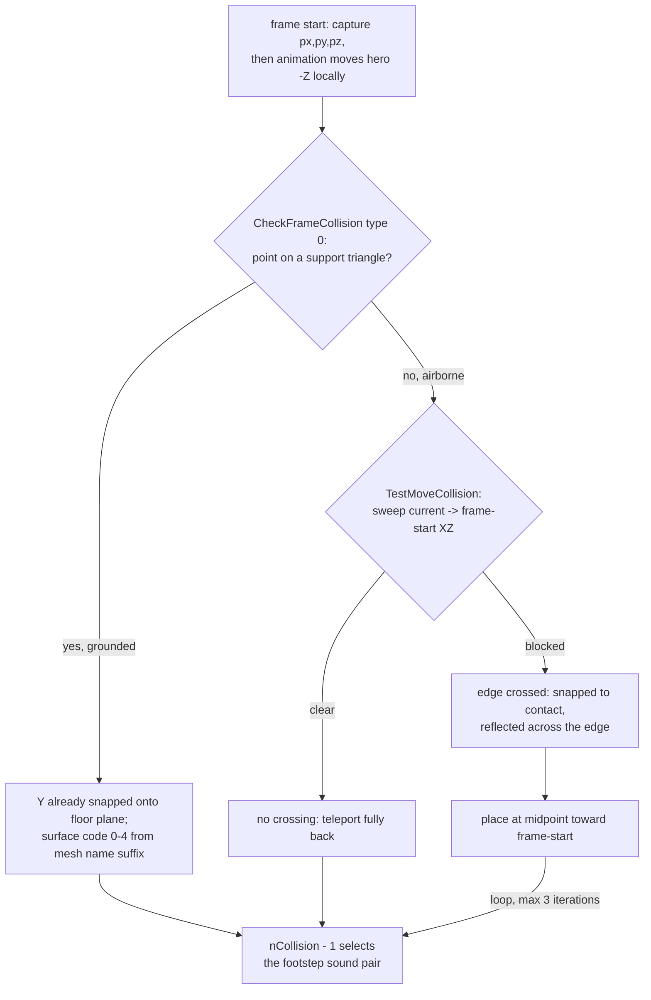
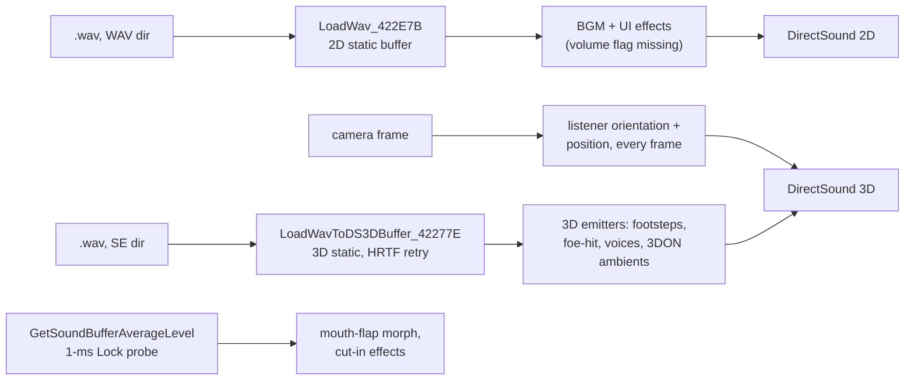
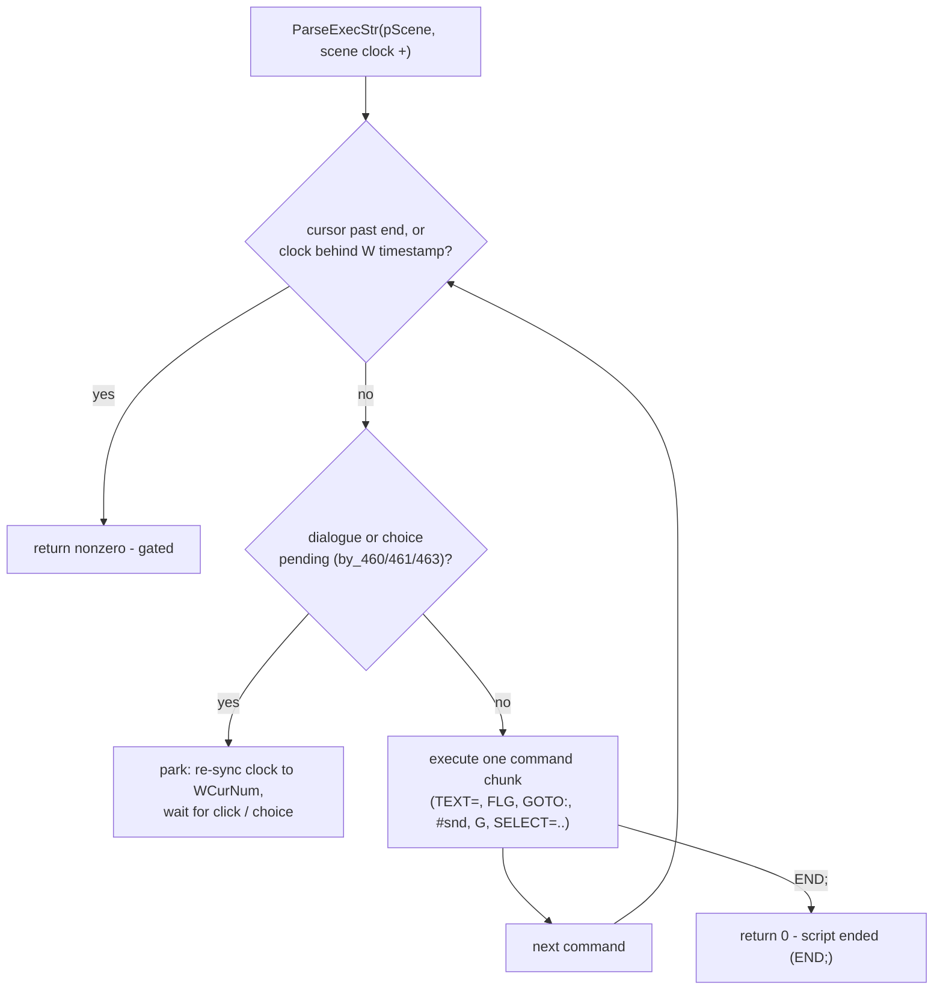

# Part V: Gameplay Subsystems

## Physics & Spatial Queries

There is no physics engine. Bodies are **points** (frame origins), motion is direct
per-frame repositioning (`SetFramePosRel_4069DD` matrix teleports, local -Z forward),
and there is no velocity or gravity state anywhere - falling is a pull-back-to-anchor,
never a ballistic arc.

### The collision kernels

All in [src/SetupHeroEntry_4593E0.cpp](../src/SetupHeroEntry_4593E0.cpp). Two recursive
entry points walk the whole map frame tree every call (only per-mesh world-AABB
fast-reject, no caching, no partitioning):

- `CheckFrameCollision_443CC5` - the vertical probe, dispatching on a type flag:
  - type 0 = **floor**: `HitSupportSurface_4423B0` tests the body point against every
    triangle in XZ (edge-function sign walk), computes the triangle plane Y, and on a
    hit within a 10-unit band *side-effects a snap onto the plane*. The return code is
    the **surface material**, parsed from the mesh name suffix (`_x`/`_w`/`_z`/`_y`
    variants) - this is what selects footstep sounds.
  - type 1 = **ceiling/overhead**: `HitOverheadSurface_442C1C` snaps the body down when
    a plane sits within `planeY + 8` of it (`g_fHitY_4C6F48` = 16.2 tunes the band).
- `TestMoveCollision_4443FC` -> `TestBodyMoveHit_443EC4` - the **wall sweep**: a 2D
  segment-vs-segment intersection in the XZ plane between the movement (current ->
  proposed) and each triangle *edge*, gated by a Y term (`edgeY^2 + 100 > moveY^2`) so
  only edges near the body's height band count. On the farthest crossing the body is
  snapped to the edge contact point, **reflected across the edge line** - that
  reflection, not any push-out, is the entire collision response. Returns a bool; all
  "correction" happens via the snap side effect.

The hero loop (`UpdateHeroControl_45A513`, identical in `UpdateHeroBody_44474E`) runs up
to three iterations: while on a support surface the loop exits immediately (walls are
never validated while grounded); airborne, it sweeps back toward the frame-start
position and bisects the remaining distance by halves per iteration. Walls work because
floor-boundary triangle edges act as implicit walls under the Y gate.

### The one spatial structure - foe pathfinding only

`BuildMapCollisionGrid_445B12` rasterizes a duel map into `g_pMapCollGrid` (200x200
cells, 5 world units each) by brute-forcing ~39,200 point probes through
`CheckFrameCollision` once at map load. That grid is the only spatial data structure in
the game, used solely by the duel foe AI: `HanaGrid_FloodFill_4460AD` +
`HanaGrid_DFSPath_445C12` run an 8-direction flood fill (approach or wander mode),
emit up to 5 waypoint cells and a first-step direction, with stuck detection and a
minimum 5-unit separation push. Hero, camera, items, and triggers never touch the grid.

### Triggers, wanas, cameras

- **Triggers are radius checks in XZ with facing gates**: items (`FindTargetInRange_45A1AD`,
  radius 8), `JUMP` scene-transition markers (radius 5.2 + must face the marker),
  `EVENT` dialogue triggers (radius 5, returning a 1000x-number script time), lock-on
  (radius 20). `IsFoeWithinHeroRange_448B78` cheats elegantly: teleports the hero 2.5
  units forward, measures, restores.
- **Wana traps** dispatch from a per-duel table into four attacks: close, knockback
  (shoves the hero to exactly 6 units), charged (XZ-only 5-unit discharge after a
  20 s buildup), and projectile - the wana frame *is* the projectile, rolling flat on
  the ground with yaw steering, no gravity or arc.
- **Cameras**: the chase camera (`UpdateCameraFollowChase_445525`) is the only one with
  collision - ceiling test, camera-to-hero sweep, and a lift heuristic when blocked,
  inside an orbital cage (max radius 10, height 15 +/- 10). The duel camera
  (`UpdateCameraFollowDuel_44C028`) deliberately has none.

Honest negatives: no raycast API, no broadphase, no body volumes (no capsule/AABB
sweeps), no separate physics timestep - collision rides the frame delta with the manual
retry loops as the only substepping.

## Audio Engine Processing

DirectSound only, via the `HanaDS_*` family in
[src/WndProcCheckSystem_485FC2.cpp](../src/WndProcCheckSystem_485FC2.cpp):
`HanaDS_Init` (`DirectSoundCreate` + `DSSCL_EXCLUSIVE` + a 40,000-byte private heap),
`HanaDS_Create3DListener` (primary buffer with `CTRL3D`; `SetDistanceFactor(1.0)`,
`SetRolloffFactor(0.001)`), `HanaDS_Shutdown`.

### Two buffer paths, everything static

- **2D** (`LoadWav_422E7B`, [src/LoadSoundEffects_47EB7F.cpp](../src/LoadSoundEffects_47EB7F.cpp)):
  `DSBCAPS_STATIC` mmio-loaded buffers - BGM and UI effects. The flags include
  `CTRLPOSITIONNOTIFY` but the notify interface is never acquired (dead flag), and they
  lack `CTRLVOLUME`, so the `SetVolume(-1000)` on UI effects silently fails - menus are
  louder than intended, faithfully so.
- **3D** (`LoadWavToDS3DBuffer_42277E`): static + `CTRL3D` with an HRTF algorithm retry
  (FULL -> DEFAULT -> LIGHT), `SetMinDistance(1499 or 0.1)`, `SetMaxDistance(500)`,
  wrapped in a `GlobalAlloc`'d `CSoundStruct_8 { buffer, 3D buffer }`. Footsteps,
  foe-hit SFX, and voices use this path.

No streaming anywhere: every buffer is filled once at load.

### Per-frame spatial update

Every rendered frame, `HanaFrame_Draw` updates the listener from the camera
(`CommitDeferredSettings` first - vestigial, nothing is ever deferred - then
`SetOrientation`/`SetPosition` from the camera frame's rotation and position, all
`DS3D_IMMEDIATE`). Emitters are re-pinned per frame: footsteps to the hero's center
(both 3D footstep sets), foe-hit SFX to the foe, and all 20 duel **voice buffers** to
the foe's face frame (`"_04_kao"`) by `UpdateVoicePlayback_458B3A`, which also
schedules them (per-state pick tables, non-current voices faded -500 dB/frame, hard
stop at the -7142 floor).

`GetSoundBufferAverageLevel` is the audio-reactivity hook: it locks a 1-ms window
centered on the play cursor and computes the mean absolute amplitude (normalized
0..1) - the mouth-flap morph weight and the cut-in scene effects are driven by it.

### Volume, BGM, pausing

Two ladders: the DirectSound dB table `g_fVolumeDbTable[10]` and the linear MCI
`arrVolSteps[10]` for AVI. Volume is applied at buffer load (per-scene offset
`field_470` from the script's `#<snd>,<vol>` opcode) and re-applied live only by the
Options tab. What looks like crossfading is render-loop `SetVolume` ramps
(-300/-500 dB per delta, stop at the floor). BGM is per-context (title `s001`
non-looped - its ending is the menu's idle-exit; menus `s004`; exploring `s007-9`;
hunting `s006/10/11`; assault `s012/3`; ending `s014`), kept alive by a `GetStatus`
resume poll in SystemMenu. `PauseSceneAudio_46A2A0` stops every animset sound and
caps its repeat counter at 9999 so the timeline will not re-arm while paused; the
3DON ambient sounds likewise play only inside authored time windows with repeat caps.

## Input Architecture

Covered mechanically in Part II: one input thread at ~120 Hz (relative mode pinning
the cursor for mouse-look, absolute mode for menus), double-buffered 30-slot history
ring published lock-free, consumed under the `MutexThreadWait` handshake. The
subsystem-level facts:

- The poller `GetCursorPos_4811FA` is plain `GetCursorPos` + `GetAsyncKeyState` button
  masks - DirectInput is initialized and acquired but never read (`GetDeviceState`
  absent). Arrow keys emulate mouse nudges of +/-9 px per press.
- **Bindings are data, not a table**: six globals hold remappable VKs
  (`g_vkBtnLeftAlt_4C7334` / `g_vkBtnRightAlt_4C7330` / `g_vkBtnMidAlt_4C7338` mouse
  alternates, `g_vkKbdLeft/Right/Up/Down_4C733C..4C7348`, `g_vkKbdEsc_4C734C`),
  re-armed by `RestartInputThread` before each thread start (defaults: mouse 88/90/32,
  arrows 37/39/38/40, ESC 27).
- Consumption patterns: `GetMouseBtn_45A41B` scans history slots 0-4 for edges and
  *consumes* middle-clicks in place (debounce); `UpdateHeroControl` sums deltas across
  the whole ring (x10 when the keyboard moved the cursor). Fixed keys: ESC opens the
  system menu, `C` toggles first-person
  (`g_nFirstPersonCam_530268`).

## Scripting & Modding Hooks

### The .STR interpreter - a timed command stream

`ParseExecStr_487D89` ([src/ParseExecStr_487D89.cpp](../src/ParseExecStr_487D89.cpp))
executes the ODS scene script with no VM of its own - the interpreter state *is* fields
of `CHanaSceneT458` (cursor triple `dwPtrPos_444` / `dwPtrCurrent_448` / `dwPtrSize_44C`,
wait timestamp `WCurNum`, mode bytes `by_460..463`). The model is **catch-up**: each
frame the scene clock advances by the delta, and the loop executes commands until a
gate trips - a `W<val>` timestamp not yet reached, a `TEXT=` dialogue box waiting for a
click, or a `SELECT=` choice pending.

| command | effect |
|---------|--------|
| `TEXT=<..>;` | render dialogue text, park until click (x1000 rush on click) |
| `HITEMGET<n>;` | OR an item bit into `girlsStateBits_98` **and** the persistent `g_sysDataSave` copy |
| `GETBOOK<n>;` | set a book-reading flag, unlock save-slot bit |
| `KUTI<...>;` / `ME<...>;` | apply mouth / eye animation params to a scene frame |
| `M+<v>;` / `M-<v>;` / `M=<v>;` | text/scene alpha multiplier (sign via atof) |
| `GO,R,G,B_<t>;` / `GI,...;` | fade out/in via `PlayScreenFade` over the scene background |
| `G<NN>;` | swap background to gallery picture `GNN.GP`, unlock it; five special NNs switch the active girl stage |
| `#<snd>,<vol>;` | scene BGM: load from the name table, apply volume offset, loop |
| `N<n>;` | flush flag for the next fade |
| `FLG<ofs><op><v>;` | arithmetic on any byte of `CSceneState` (offset from `bCurrentSubStage`, `op` in `= += -= *= /=`) |
| `GOTO:<label>;` | flat text search for the label (forward, then backward) - no stack |
| `IF(FLG<i><op><v>)GOTO:<l>;` | branch on a `CSceneState` byte |
| `IF(OFLG<i><op><v>)GOTO:<l>;` | branch on a persistent `g_byData0Dat` byte |
| `F<t>;` | jump the scene exec clock |
| `SELECT=<..>*..*..*;` | enter choice mode: glyph grid built, interpreter parks until the renderer picks a `*` branch (cursor left right after the chosen marker) |
| `LPU;` | heal the protagonist 20% of max |
| `END;` | script finished - return 0 |

Faithful decompile quirks kept: `CompareByte` never clears its output flag before
evaluating (callers pass uninitialized locals), and the single-char `>` / `<`
operators do not advance the cursor before `atoi` (so the value parses as 0). Return
protocol: 0 = ended (dialogue scenes exit, exploring exits dialogue mode, assault
rewinds the cursor); non-zero = gated, continue next frame.

### The modding layer of this rebuild

The rebuild itself is the mod framework (see Part I for the hook mechanism):

- **Two entry points**: standalone `exemain.cpp` (everything `cfg=1`, pure recompiled
  game) vs injected DLL (`dllmain.cpp` -> `InitHNH` in
  [hnh_main.cpp](../hnh_main.cpp): only `CheckRunGame` and `GameMainLoop` detour at
  `cfg=2` while the rest of the rebuild stays dormant; `hookWinMain` blocks on
  `g_hStartEvent` until installation finishes, then boots the embedded interpreter).
- **[user32hook.cpp](../user32hook.cpp)**: MinHooks six user32 exports - `PeekMessageA`
  forwards input messages to the ImGui handler (the game's own WndProc hook is
  disabled), `GetWindowRect` fakes a 1280x960 desktop so the popup window sizes
  correctly, and `GetAsyncKeyState` returns 0 while the mod menu owns input
  (`IsGameInputOn` - which also freezes the two input threads and the cursor poller).
- **Embedded Python** ([python_repl.cpp](../python_repl.cpp)): a pybind11 interpreter
  with exactly two game bindings - `read_mem(address, size)` and
  `write_mem(address, data)` raw memory access - plus a docked REPL with tab
  completion and a Jupyter-style cell view (both currently compiled but not
  rendered). `dynstruct.hpp` provides schema-driven struct inspection/pretty-printing
  infrastructure, currently dormant.
- **ImGui windows**: `DrawHNH` renders a World Viewer over `g_sceneState_52F7E0`
  (live scene step, sub-stages, item bits, HP, selection mask) with a static layout
  assert (`sizeof(CSceneState) == 0x190`).
- **Logging**: `DebugLog` / `ONCELOG` (once per call site) / `EVERYLOG` (every Nth)
  write to the ImGui console, a Shift-JIS-aware (CP 932) debug console, and
  `Universal-ImGui-Hook.log`; every rebuilt function opens with an
  `ONCELOG("[HNH:SUB] ...")` breadcrumb.
- **Resources**: the mod binary ships its own icon and cursor
  (`res/icon.ico` 0x69, `res/cursor.cur` 0x68) loaded by the rebuilt window classes,
  so the standalone exe looks the part.
