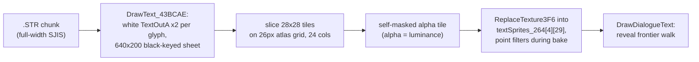
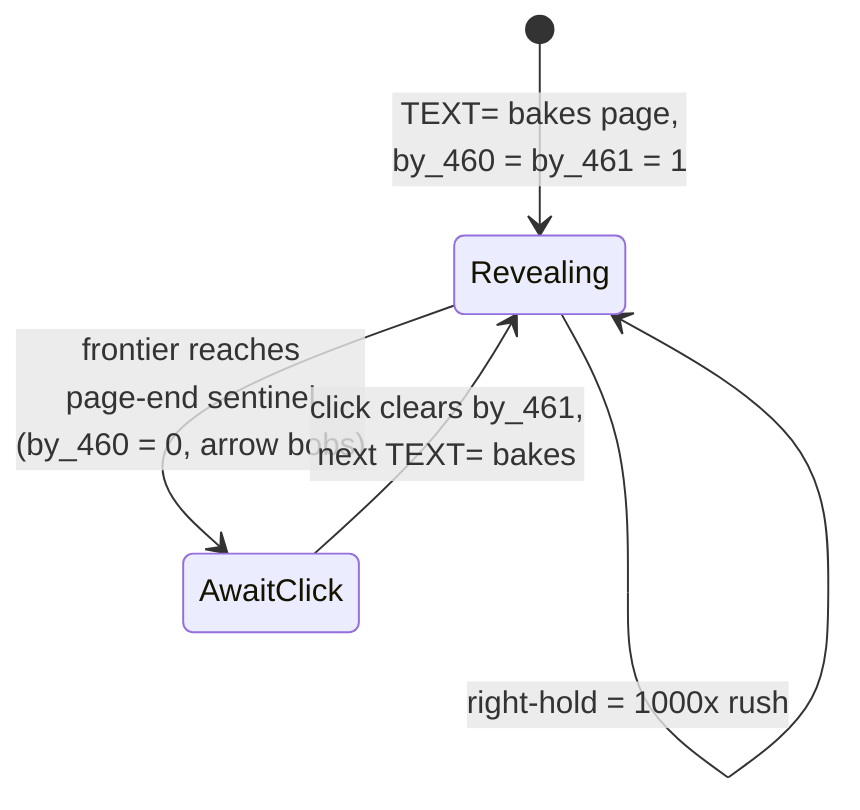

# Part VIII: Text, Font & UI Pipeline

The UI is two families. **Chrome is bitmaps** - windows, buttons, gauges, tab strips are
all masked BMP sprites (Parts III/IV). **All text is GDI-rasterized at runtime**: only
dialogue/choice glyphs are baked into D3D textures (the `textSprites_264` grid);
every menu label is drawn per frame with `TextOutA` straight onto the back buffer.
There are no prerendered text atlases and no text in any asset file except the `.STR`
scripts themselves.

## The Font

One GDI face for the whole game: **MS Mincho** (full-width SJIS, bytes
`82 6C 82 72 20 96 BE 92 A9`), selected by `SetUiFont_419BCD`
([src/WndProcCheckSystem_485FC2.cpp](../src/WndProcCheckSystem_485FC2.cpp)):

- `CreateFontA(nFontH, nCharW/2, 0, 0, 400, 0, 0, 0, SHIFTJIS_CHARSET, 0, 0, 2, 0x30,
  face)` - weight 400, width is half the char cell (the halfwidth advance).
- Sizes in play: **26x26** is the engine default (set at the end of
  `Renderer_InitializeTrigTablesAndPixelFormat`); **15x15** while SystemMenu is open
  (restored to 26 on exit); the YesNo dialog temporarily jumps to 26x26. The title
  launcher keeps its own separate font (`g_hFontTitleMenu`, 14x7) on the plain window
  DC.
- Globals: `g_hFont` (@0x518378), `g_dwCharWidth` (@0x4B01B4 - just the stored
  argument, read by the GDI label helpers as the per-char advance), and
  `g_dwFontHeight` (@0x4B01B8 - **write-only**, never read anywhere).
  `Renderer_CleanupFont_41888E` deletes the font at teardown.

There is no `GetTextExtentPoint`/`GetTextMetrics` anywhere - every measurement is the
hard-coded 26-pixel full-width cell.

## The Rasterizer - DrawText_43BCAE

([src/MenuCharSelect.cpp](../src/MenuCharSelect.cpp)) The only dialogue rasterizer:

1. Scratch DirectDraw surface sized to the clip rect, filled black, black color key.
2. `GetDC`, select `g_hFont`, `SetTextColor(0xFFFFFF)` - **always white**;
   `SetBkMode(TRANSPARENT)` so black becomes the alpha-0 key later.
3. **Full-width-only SJIS walk**: every glyph is drawn as a 2-byte `TextOutA` **twice,
   at x and x+1** (a 1-pixel faux bold), then `x += 26`. Halfwidth ASCII `A`-`z`, `;`
   and `,` are command bytes - skipped, one byte, no advance. The line wraps at 24
   glyphs; rows step 26 px. `CheckSpecialJpChar_43BFFA` whitelists the seven SJIS
   trailing-punctuation marks so lines can break after them but not before.
4. Result blitted to the target surface at `top + 2`.

No color, ruby, or name-prefix markup exists in text chunks - tinting happens at draw
time via sprite alpha only.

## Baking a Page

Two bakers share one pipeline ([src/CheckInstalledDirRoot_4869A7.cpp](../src/CheckInstalledDirRoot_4869A7.cpp)):

- `ParseStrChunkText_47FF01` (the `TEXT=` command): scans the script from the restart
  mark `dwPtrPos_444` in 2-byte steps until `;` (statement end), `*` (page break), or
  an ASCII letter (next command).
- `Scene_CreateFontTextureFromStringData_47F460` (the `SELECT=` command): first
  copies the choice text into a 512-byte buffer where **`,` is a newline**, padded
  with halfwidth spaces to the next 54-byte (27-glyph) row boundary.

Both then:

1. `DrawText_43BCAE` the chunk into a **640x200 sheet**.
2. Slice it into **28x28 tiles on a 26-pixel atlas grid** (24 columns per row - the
   +2 overlap keeps glyph edges from clipping) via `BltFast` into a 28x28 scratch
   surface.
3. `CreateTextureFromSurfaceWithAlphaMask(tile, tile)` - the tile masks itself, so
   alpha = own luminance (white text in, black key out).
4. `CHanaObj__ReplaceTexture3F6` the result into the linear `textSprites_264[4][29]`
   grid (only 27 columns are actually allocated; the fill is a straight linear
   counter, no row/col math).
5. Filters forced to point sampling and ANTIALIAS off during the bake, restored
   linear after; `g_dwFontRenderFlag` (the reveal counter) reset to 0.

The `TEXT=` baker additionally sets the **page-end sentinel**: the sprite at column =
chunk glyph count gets `bOk_10C = 1`, which stops the reveal walk. The SELECT baker
skips the sentinel and hides the window-frame sprite instead.

## The Dialogue Window

Five window sprites from seven BMPs
(`LoadBmpWithMask` pairs, [src/PlayOdsDialogueScene_477F90.cpp](../src/PlayOdsDialogueScene_477F90.cpp)):

| slot | texture/mask | role |
|------|--------------|------|
| `[0]` | window2 / window1 | scrolling "text tape" background strip |
| `[1]` | window3 / window3 | bobbing next-page arrow |
| `[2]` | window4 / window4 | static next-page base |
| `[3]` | window5 / window6 | the dialogue/choice window frame |
| `[4]` | window7 / window7 | choice-row hover highlight strip |

Exactly one window frame - not per-girl, not per-mood. `DrawDialogueWindow_480B2D`
switches mode on the sign of `flt_454` (the window fade envelope):

- **Scrolling mode** (`flt_454 > 0`): the frame fades out at `0.1*delta` while the
  tape `[0]` draws in **three parallax passes** (source offsets `scroll/2`, `scroll/3`,
  `scroll/4` from the `g_fFrameTime_52F1B4` accumulator, with `D3DTSS_ADDRESS = WRAP`
  so the negative source lefts tile seamlessly), then `DrawDialogueText_4803B5`.
- **Static/select mode** (`flt_454 <= 0`): the frame fades in at `0.05*delta` drawn
  as **two mirrored halves** (left half normal, right half horizontally flipped), then
  `DrawAdvanceDialogueText_47FA84` renders the choices.

The envelope fields (updated by `UpdateSceneTimer_4827FE`):

| field | meaning | writers |
|-------|---------|---------|
| `flt_450` | ~10 s glyph-brightness ramp (gated by `by_461`) | scene timer |
| `flt_454` | window fade envelope; sign selects the mode | `M=` script cmd, choice pick, assault rewind |
| `flt_458` | envelope rate | `M+`/`M-` script cmds, `SELECT=` (-0.05), choice (+0.05) |

## Reveal and Advance

`DrawDialogueText_4803B5` walks the glyph grid against a **reveal frontier**:
`g_dwFontRenderFlag += fFrameTime * 30`, and `flag / 100` is the number of revealed
glyphs. Settled glyphs draw with alpha `flt_450 * flt_454` - **each glyph drawn
twice** (alpha compounds); the leading 5 glyphs get a fading tail with slide-in
geometry (`+10/-10 x`, `+4..+32 y` by `(1-fade)`). Glyph quads use `ADDRESS = CLAMP`.

The click-to-advance handshake:

- The **next-page indicator** appears exactly when the reveal finishes: window4 base
  at a fixed corner plus the window3 arrow bobbing on `sin(flag/180)*5 + 432`.
- A click while `by_461 && !by_460` clears `by_461`, unblocking the script (identical
  in dialogue, exploring, and assault loops).
- **Skip mode** (middle-click) gates the entire window draw *and* `ParseExecStr` -
  the scene just runs its animation clock. Right-button x5 speed is disabled while
  skipping.
- There is **no voice coupling** - reveal is purely timer-driven; audio never gates
  text.

## Choices

`DrawAdvanceDialogueText_47FA84` renders the baked rows at 22 px cells with a 32 px
row pitch (rows at y 270/302/334), inheriting the window frame's alpha, each glyph
drawn twice. Three hover bands (the 4th grid row is never selectable) highlight with
the window7 strip under an **additive** blend (`DESTBLEND = ONE`). A click in band k
walks up to 200 bytes from the cursor counting `*` markers and stops right after the
k-th one - leaving `dwPtrCurrent_448` inside choice k's branch - then clears
`by_463` and hands the window back to scrolling mode (`flt_454 = 0`, `flt_458 =
+0.05`).

## The Text-Speed Chain

`g_nTextSpeed_530267` (from `data0.dat`, default 1) indexes
`arrTextSpeedMult = {1.0, 2.5, 5.0}` inside `DrawDialogueWindow`. The multiplier is
applied to the delta *before* it is banked into the tape scroll and reveal counters.
On top of that: a left-click edge sets the scene's rush factor to 1000x (carried
through `frameTimeMultiplied_180`), and holding the right button while a page is
still revealing forces a 1000x reveal for that frame. The Options tab draws its
3-cell selector from the `syoubt.bmp` sheet.

## GDI Labels - the Rest of the UI

`DrawTextOnSurface` / `DrawTextOnSurfaceSpaced_419B05` draw per-frame labels onto the
back buffer through `GetDC_4188B4` (the 30-retry DC wrapper), advancing
`i * g_dwCharWidth/2` per char (the Spaced variant takes a caller pitch - the
Graphics tips use -2):

- **Save/Load tabs**: the "diary name" is the save file's *timestamp*, formatted as
  full-width digits plus year/month/day kanji (built by `FormatFileLastWriteTime_461397`
  with the `ZeroPadNumberToString_4612B0` full-width digit patcher - the digits are
  literally the SJIS zero glyph with the trail byte incremented). Seven info lines
  below come from the
  compiled-in diary table `g_szSceneInfoText_4B5A10[40][20][80]`, block picked by the
  chapter thresholds; a status line names the scene type.
- **Girl status tab**: HP digits drawn right-to-left, white - switching to **red
  below one-third** HP.
- **YesNo dialog**: caption centered at `320 - len*26/4` in the temporarily-larger
  26x26 font.

## Quirks Worth Keeping

- The atlas wraps at **24** columns but the sprite grid is declared `[4][29]` with
  only **27** columns allocated - the linear fill reconciles them only because
  raster lines stay within the wrap width.
- Every dialogue glyph is drawn **twice per frame** (deliberate double-alpha).
- `g_dwFontHeight` is written and never read.
- The 28x28 tile on a 26px grid pitch leaves a 2px shared edge between atlas cells -
  the `+2` in every slice rect.
- The SELECT buffer is pre-filled with 250 halfwidth spaces and NUL-terminated at
  251 - fixed 252-byte rows regardless of content.
